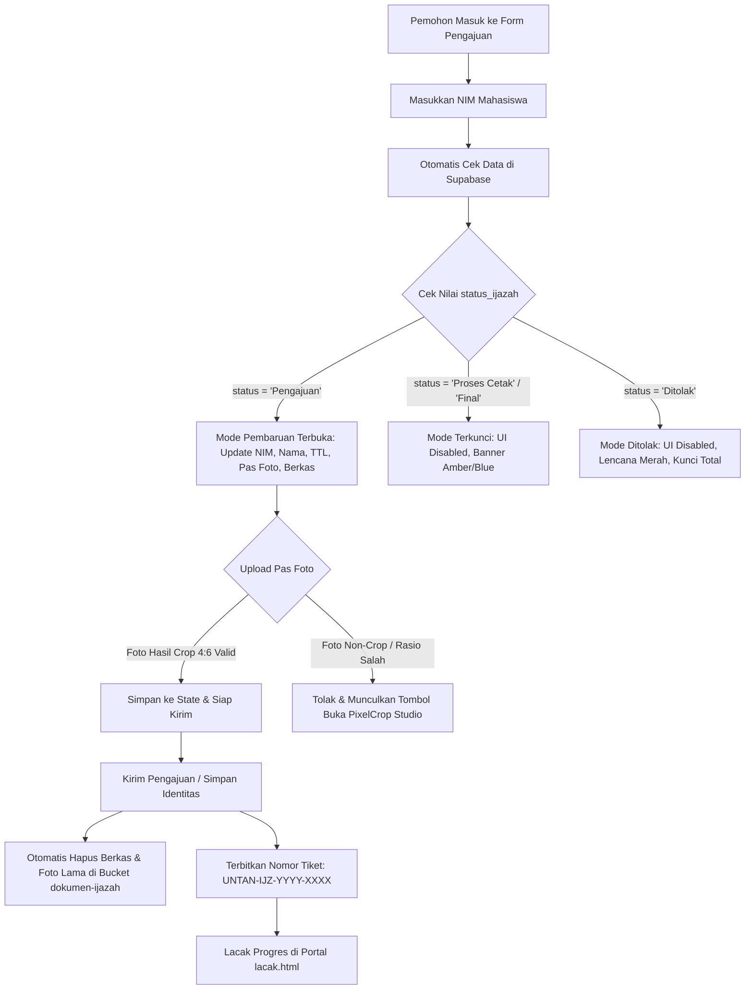

# PRD Portal Layanan Penerbitan Ijazah Universitas Tanjungpura

**Versi Dokumen:** 3.5  
**Status:** Disahkan & Disesuaikan dengan Seluruh Implementasi Terakhir  
**Tanggal Pembaruan:** 1 November 2026  
**Kepemilikan:** Biro Akademik dan Kemahasiswaan (BAK) Universitas Tanjungpura & Tim Pengembang SimalumApps  

---

## 1. Ringkasan Eksekutif & Visi Produk

Portal Layanan Penerbitan Ijazah Universitas Tanjungpura (UNTAN) adalah ekosistem digital terintegrasi yang melayani mahasiswa tingkat akhir, wisudawan, dan alumni UNTAN dalam pengurusan administrasi ijazah dan dokumen kelulusan secara transparan, akuntabel, dan aman.

Sistem ini telah bertransformasi dari sekadar landing page statis menjadi **Portal Administrasi Kelulusan Terpadu Berbasis Cloud & WebAssembly** yang terdiri dari 6 pilar antarmuka dan 1 pilar pangkalan data terintegrasi:
1. **Beranda & Katalog Layanan** (`public/index.html`)
2. **Panduan & Dokumen Persyaratan** (`public/panduan.html`)
3. **Formulir Pengajuan Permohonan Online** (`public/pengajuan.html`)
4. **Pelacakan Status Pengajuan Real-Time** (`public/lacak.html`)
5. **PixelCrop Studio - Pemotong Pas Foto Standar 4×6 Rust WebAssembly** (`public/crop/`)
6. **Portal Pengguna & Autentikasi Multi-Faktor (MFA)** (`public/user/`)
7. **Pangkalan Data Supabase & Object Storage `dokumen-ijazah`** (`supabase/schema.sql` & `public/js/supabaseClient.js`)

Portal ini terintegrasi dengan ekosistem **Simalum Untan**, pangkalan data **PISN Kemdiktisaintek**, penyimpanan berkas cloud **Supabase Storage**, serta sertifikasi **Tanda Tangan Elektronik (TTE) BSrE - BSSN**.

---

## 2. Sasaran Pengguna & Pemangku Kepentingan

| Entitas Pengguna | Karakteristik & Kebutuhan Utama |
| :--- | :--- |
| **Wisudawan / Lulusan Baru** | Pengambilan fisik ijazah & transkrip asli pertama kali pasca-yudisium di Subbagian Akademik Fakultas, pemutakhiran mandiri identitas ijazah (NIM, Nama, TTL), serta pembuatan dan pengunggahan pas foto resmi 4×6 hasil crop. |
| **Alumni (Koreksi Data)** | Mengajukan pembetulan ejaan nama, NIK, tempat/tanggal lahir yang tidak sesuai antara dokumen kependudukan (Dukcapil) dan fisik ijazah lama. |
| **Alumni (Kehilangan / Kerusakan)** | Mengajukan Surat Keterangan Pengganti Ijazah (SKPIj) akibat rusak berat/hilang dengan melampirkan berkas kepolisian (STPLK) dan SPTJM. |
| **Biro Akademik & Kemahasiswaan (BAK)** | Verifikator berkas legalitas di Gedung Rektorat Lantai 1, pengelola siklus `status_ijazah`, pemantau antrean pencetakan, dan penjamin validitas hukum penomoran ijazah nasional. |
| **Subbagian Akademik Fakultas** | Unit pelaksana verifikasi SK yudisium dan loket penyerahan fisik dokumen ijazah baru bagi lulusan baru fakultas masing-masing. |

---

## 3. Arsitektur Informasi & Struktur Sistem

```
Portal Layanan Penerbitan Ijazah UNTAN
├── 1. Beranda (public/index.html)
│   ├── Top Header (Logo Resmi Untan, Mega Menu 3-Kelompok, Tombol Mandiri PixelCrop WASM, Avatar Pengguna, Drawer Mobile)
│   ├── Animated Glassmorphism Hero Section (Fluid Typography Clamp, Aurora Orbs, Badge Verified)
│   ├── Katalog 5 Kartu Layanan Resmi (Penerbitan Baru, Perbaikan Data, Penerbitan Ulang, Pencetakan Ulang, Ijazah TTE)
│   ├── Alur & Prosedur Pengajuan (4 Langkah Transparan)
│   ├── Ringkasan Persyaratan & Dokumen Legalitas (Tabbed Interface)
│   ├── Pusat HelpDesk & Pertanyaan Umum (FAQ Interaktif)
│   ├── Callout Kontak & Jam Layanan Terpadu Gedung Rektorat
│   └── Footer Akademik & Integritas Dokumen BSrE
├── 2. Panduan & Prosedur (public/panduan.html)
│   ├── Regulasi BAK & Dasar Hukum (Permendikbudristek No. 6/2022)
│   ├── Standar Pas Foto Resmi Wisuda UNTAN (Latar Biru, Kertas Doff)
│   ├── SOP Alur Pengajuan Tiap Kategori Layanan
│   └── Daftar Periksa Berkas & Prosedur Pengesahan
├── 3. Formulir Pengajuan (public/pengajuan.html)
│   ├── Pemilihan Layanan Dinamis (Radio Cards)
│   ├── Cek Data Mahasiswa Otomatis via NIM (Pangkalan Data Supabase)
│   ├── Pembaruan Mandiri Identitas (NIM, Nama Lengkap, Tempat Lahir, Tanggal Lahir)
│   ├── Area Unggah Pas Foto Khusus Hasil Crop 4:6 (Validasi Dimensi & Rasio Otomatis)
│   ├── Penerima Hasil Crop Otomatis dari PixelCrop Studio (DataTransfer & Anti-Overwrite Protection)
│   ├── Penegakan Aturan Penguncian (Locking Rules berdasarkan status_ijazah)
│   ├── Banner Status Verifikasi & Banner Penguncian Interaktif
│   └── Modal Registrasi Sukses dengan Tiket Resmi (Format: UNTAN-IJZ-YYYY-XXXX)
├── 4. Lacak Status Pengajuan (public/lacak.html)
│   ├── Pencarian Berkas Real-Time via NIM atau Nomor Tiket
│   ├── Lencana Status Ijazah Berwarna (Pengajuan, Proses Cetak, Final, Ditolak)
│   ├── Timeline Siklus Pengajuan (Verifikasi -> Antrean Cetak -> Pengesahan -> Siap Ambil)
│   └── Informasi Rinci Lokasi Pengambilan Fisik & Unduhan Bukti
├── 5. PixelCrop Studio (public/crop/)
│   ├── Engine Pemrosesan Citra Client-Side Rust WebAssembly (Zero Server Upload)
│   ├── Preset DPI Terkunci Aspek Rasio 4:6 (300 DPI, 400 DPI, Konversi Digital)
│   ├── Kanvas Interaktif: Zoom, Pan, Rotasi Halus, Rotasi 90°, Flip, Grid Rule-of-Thirds
│   ├── Integrasi Multi-Trigger "Gunakan di Pengajuan":
│   │   ├── Tombol Header Atas (#top-use-pengajuan-btn)
│   │   ├── Tombol Floating Tool Dock (#dock-btn-use-pengajuan)
│   │   ├── Tombol Footer Sidebar (#direct-use-pengajuan-btn)
│   │   └── Tombol Modal Hasil Pratinjau (#use-in-pengajuan-btn)
│   └── Penyimpanan Storage Cepat & Navigasi Mulus (/pengajuan.html?cropped=1)
├── 6. Portal Pengguna & Autentikasi Multi-Faktor (public/user/)
│   ├── Beranda Dasbor Pengguna (public/user/index.html)
│   │   ├── Ringkasan Profil Akademik & Status Terhubung Supabase
│   │   ├── Pengaturan Autentikasi Multi-Faktor (MFA)
│   │   │   ├── Toggle Pengaktifan MFA Global
│   │   │   ├── Pilihan Metode Utama: Surel (Email OTP) atau Smartphone (Authenticator App / TOTP)
│   │   │   ├── Generator Kunci Rahasia TOTP & Integrasi Aplikasi Google/Microsoft Authenticator
│   │   │   └── Generator & Daftar 8 Kode Pemulihan Cadangan (Backup Codes)
│   │   ├── Formulir Pembaruan Kata Sandi Mandiri (Verifikasi Password Lama & Konfirmasi Baru)
│   │   └── Status Pengajuan Ijazah Mahasiswa Terintegrasi Real-Time
│   ├── Masuk Akun & Autentikasi Kredensial (public/user/login.html)
│   │   ├── Input Pengenal (NIM atau Email) & Kata Sandi
│   │   ├── Validasi Kriptografi Hash SHA-256 + Salt Sisi Klien
│   │   ├── Pintasan 1-Klik Uji Coba Akun Demo (Budi Santoso & Siti Aminah)
│   │   └── Pengalihan Cerdas: Ke Layar MFA (jika aktif) atau Langsung ke Dasbor
│   ├── Layar Verifikasi Multi-Faktor / MFA (public/user/mfa.html)
│   │   ├── Panel Pilihan Metode Verifikasi Berbasis Tab:
│   │   │   ├── Tab 1: Verifikasi Surel (Email OTP 6-Digit)
│   │   │   ├── Tab 2: Smartphone Authenticator (TOTP RFC 6238 6-Digit)
│   │   │   ├── Tab 3: SMS OTP (Pesan Singkat Seluler)
│   │   │   └── Tab 4: Kode Pemulihan Cadangan (Emergency Backup Code)
│   │   ├── Penanganan Sesi Verifikasi Sementara (Session Token 10 Menit)
│   │   └── Penyelesaian Sesi Autentikasi Penuh & Penyimpanan Status Login
│   ├── Permintaan Reset Kata Sandi / Lupa Password (public/user/forgot-password.html)
│   │   ├── Input NIM atau Surel Terdaftar
│   │   ├── Penerbitan Token Kriptografis Unik (32-Byte Hex) & Kode OTP 6-Digit
│   │   ├── Simulasi & Pratinjau Pengiriman Tautan Reset Instan untuk Pengujian
│   │   └── Masa Berlaku Token Terbatas (1 Jam)
│   ├── Pembaruan Kata Sandi Baru / Reset Password (public/user/reset-password.html)
│   │   ├── Validasi Token Reset dari Parameter URL (?token=...&email=...) atau Kode OTP
│   │   ├── Pengecekan Integritas & Status Token Belum Digunakan (is_used = false)
│   │   ├── Input Kata Sandi Baru & Konfirmasi (Minimal 8 Karakter)
│   │   ├── Pencatatan Riwayat Password Lama (Tabel password_history)
│   │   └── Pembaruan Hash Kata Sandi di Basis Data & Notifikasi Sukses
│   └── Engine Autentikasi Klien (public/user/userAuth.js)
│       ├── Kriptografi Web Crypto API Standar Industri (SubtleCrypto SHA-256)
│       ├── Engine TOTP RFC 6238 Murni JavaScript (HMAC-SHA1 30 Detik)
│       ├── Generator OTP 6-Digit Kriptografis Aman
│       └── Penanganan Sesi LocalStorage Terproteksi & Fallback Otomatis
└── 7. Pangkalan Data & Cloud Storage (supabase/schema.sql & public/js/supabaseClient.js)
    ├── Tabel Utama Pengajuan: pengajuan_ijazah (status_ijazah enum & metadata lengkap)
    ├── Tabel Akun Pengguna: public.users (identitas, nim, email, password_hash, password_salt, role, status)
    ├── Tabel Pengaturan MFA: public.user_mfa_settings (user_id, is_mfa_enabled, primary_method, authenticator_secret, backup_codes)
    ├── Tabel Permintaan Reset Password: public.password_reset_requests (user_id, reset_token, otp_code, expires_at, is_used)
    ├── Tabel Verifikasi Sesi MFA: public.mfa_verifications (user_id, method, session_token, otp_code, expires_at, is_verified)
    ├── Tabel Riwayat Kata Sandi: public.password_history (user_id, password_hash, changed_at, changed_via)
    ├── Tabel Audit Log Masuk: public.user_login_logs (user_id, identifier, status, auth_method, ip_address, user_agent)
    ├── Bucket Object Storage: dokumen-ijazah (isolasi berkas pas foto & dokumen persyaratan)
    ├── Mekanisme Pembersihan Otomatis Berkas Lama (Auto-delete Replaced Files)
    ├── Validasi Klien Strict Dimensi Crop 4:6
    └── Konfigurasi Kredensial Fleksibel (Proyek Resmi: kfspavyphfteuowfqrau)
```

---

## 4. Rincian Fungsional 5 Layanan Ijazah

Portal menyajikan 5 klasifikasi layanan resmi dengan ketentuan operasional yang telah diselaraskan:

### 4.1. Penerbitan Baru
- **Deskripsi:** Pengajuan dan pencetakan fisik ijazah pertama kali bagi lulusan yang telah disahkan melalui SK Yudisium periode wisuda berjalan.
- **Fitur Pembaruan Data Mandiri:** Pemohon dapat memperbarui secara mandiri data **NIM, Nama Lengkap, Tempat Lahir, dan Tanggal Lahir** serta pas foto selama status ijazah masih dalam tahap `Pengajuan`.
- **Validasi Data:** Terhubung dengan Penomoran Ijazah Secara Nasional (**PISN Kemdiktisaintek**), **Simalum Untan**, dan basis data Supabase.
- **Ketentuan Pas Foto:** Pas foto yang diunggah **wajib merupakan hasil crop standar 4:6** (rekomendasi 450 × 660 px pada 300 DPI). Berkas non-crop akan ditolak oleh sistem dan dilarang masuk ke bucket penyimpanan.
- **Lokasi Pengambilan Fisik:** **Khusus Penerbitan Baru, ijazah asli dan transkrip nilai diambil langsung di Subbagian Akademik Fakultas masing-masing**, bukan di loket BAK Gedung Rektorat.
- **Biaya:** Gratis (Subsidi BLU UNTAN / beban SPP yudisium).

### 4.2. Penerbitan Perbaikan
- **Deskripsi:** Pengajuan perbaikan data atau koreksi kesalahan redaksional/ejaan nama, tanggal lahir, NIK, dan gelar pada fisik ijazah terdahulu.
- **Persyaratan Wajib:**
  1. Ijazah dan transkrip nilai asli terdahulu (wajib diserahkan ke BAK untuk penarikan fisik resmi).
  2. Akta kelahiran / Ijazah pendidikan sebelumnya sebagai dokumen pembanding keabsahan.
  3. Surat Rekomendasi/Pengantar dari Dekan Fakultas terkait.
- **Lokasi Pengurusan & Pengambilan:** Loket Pelayanan Terpadu BAK Rektorat Lantai 1.

### 4.3. Penerbitan Ulang
- **Deskripsi:** Penggantian dokumen ijazah yang mengalami kerusakan berat atau hilang total sesuai ketentuan Permendikbudristek No. 6 Tahun 2022. Dokumen diterbitkan dalam bentuk **Surat Keterangan Pengganti Ijazah (SKPIj)** yang memiliki kekuatan hukum setara ijazah asli.
- **Persyaratan Wajib:**
  1. Surat Tanda Penerimaan Laporan Kehilangan (STPLK) asli dari Kepolisian RI setempat.
  2. Surat Pernyataan Tanggung Jawab Mutlak (SPTJM) bermeterai Rp10.000,-.
  3. Bukti setor tarif PNBP resmi sebesar **Rp 200.000,-** ke rekening BLU UNTAN.
  4. Pas foto standar ijazah 4×6 cm terbaru hasil crop.
  5. Fotokopi ijazah lama/legalisasi terdahulu (jika ada).
- **Lokasi Pengurusan & Pengambilan:** Loket Pelayanan Terpadu BAK Rektorat Lantai 1.

### 4.4. Pencetakan Ulang
- **Deskripsi Resmi:** **Pencetakan ulang adalah proses penerbitan salinan ijazah atau sertifikat dari bentuk digital ke dalam bentuk fisik. Persyaratan utama tersedianya ijazah TTE yang terverifikasi.**
- **Status Operasional Saat Ini:** Segera Hadir (*Coming Soon*).
- **Status Tombol:** Non-aktif (*disabled*) dengan label `Menunggu Ijazah TTE Tersedia`. Layanan ini dirancang untuk beroperasi penuh begitu infrastruktur ijazah digital TTE resmi diterbitkan secara massal.

### 4.5. Ijazah TTE (Tanda Tangan Elektronik)
- **Deskripsi:** Layanan penerbitan ijazah digital asli dengan sertifikat elektronik terenkripsi dari Balai Sertifikasi Elektronik (BSrE) Badan Siber dan Sandi Negara (BSSN).
- **Fitur Utama:** Keamanan kriptografis anti-pemalsuan, verifikasi barcode hash instan, dan hak unduh mandiri wisudawan melalui portal.
- **Status Operasional Saat Ini:** Segera Hadir (*Coming Soon*).
- **Roadmap & Estimasi Operasional:** **Diperkirakan tersedia untuk yudisium mulai semester genap 2027/2028 secara otomatis**.
- **Status Tombol:** Non-aktif (*disabled*) dengan label `Informasi segera tersedia`.

---

## 5. Arsitektur Basis Data Supabase & Aturan Bisnis Terpadu

### 5.1. Skema Tabel `pengajuan_ijazah` (`supabase/schema.sql`)

```sql
CREATE TABLE IF NOT EXISTS public.pengajuan_ijazah (
    id UUID PRIMARY KEY DEFAULT gen_random_uuid(),
    nomor_tiket VARCHAR(50) UNIQUE NOT NULL,
    service_type VARCHAR(50) NOT NULL,
    status_ijazah VARCHAR(50) NOT NULL DEFAULT 'Pengajuan',
    nim VARCHAR(30) NOT NULL,
    nik VARCHAR(30),
    nama_lengkap VARCHAR(255) NOT NULL,
    tempat_lahir VARCHAR(100),
    tanggal_lahir DATE,
    fakultas VARCHAR(100),
    prodi VARCHAR(100),
    periode_yudisium VARCHAR(50),
    ipk VARCHAR(10),
    whatsapp VARCHAR(30),
    email VARCHAR(100),
    foto_url TEXT,
    berkas_syarat_urls JSONB DEFAULT '{}'::jsonb,
    alasan_permohonan TEXT,
    catatan_petugas TEXT,
    created_at TIMESTAMP WITH TIME ZONE DEFAULT timezone('utc'::text, now()) NOT NULL,
    updated_at TIMESTAMP WITH TIME ZONE DEFAULT timezone('utc'::text, now()) NOT NULL
);
```

### 5.2. Siklus Nilai `status_ijazah` & Representasi Lencana UI

Kolom `status_ijazah` mengontrol status dokumen secara ketat dengan 4 nilai legal:

| Nilai `status_ijazah` | Arti & Siklus Administrasi | Representasi Lencana (UI Badge) | Akses Edit & Upload |
| :--- | :--- | :--- | :--- |
| **`Pengajuan`** | Berkas terdaftar di pangkalan data dan dalam antrean verifikasi administrasi awal. | **Kuning / Hijau Muda** (`bg-emerald-100 text-emerald-800 border-emerald-300`) | **TERBUKA (Bisa Edit & Unggah)** |
| **`Proses Cetak`** | Berkas telah divalidasi BAK & Kementerian, sedang dalam proses penomoran PISN atau antrean cetak blangko fisik. | **Oranye / Amber** (`bg-amber-100 text-amber-900 border-amber-300`) | **TERKUNCI (Read-Only)** |
| **`Final`** | Ijazah fisik telah selesai dicetak, ditandatangani, dan siap diambil di loket yang ditentukan. | **Biru / Hijau Tua** (`bg-blue-100 text-blue-900 border-blue-300`) | **TERKUNCI (Read-Only)** |
| **`Ditolak`** | Permohonan ditolak karena ketidaksesuaian berkas hukum, dokumen tidak lengkap, atau data yudisium tidak cocok. | **Lencana Merah Tegas** (`bg-red-100 text-red-800 border-red-300`) | **TERKUNCI (Read-Only)** |

### 5.3. Aturan Penguncian Mutlak (*Locking Rule*)
Sistem menerapkan **Rule Penguncian Terpusat**:
> **"Pembaruan data identitas (NIM, Nama Lengkap, Tempat Lahir, Tanggal Lahir), pengunggahan berkas persyaratan, dan pengunggahan pas foto HANYA DAPAT DILAKUKAN jika `status_ijazah = 'Pengajuan'`."**

- **Validasi Sisi Klien:** Form mendeteksi status mahasiswa yang dimuat. Jika status `Proses Cetak`, `Final`, atau `Ditolak`, tombol submit, tombol simpan identitas, dan input berkas langsung dinonaktifkan (`disabled`) disertai banner peringatan resmi.
- **Validasi Klien Supabase (`supabaseClient.js`):** Fungsi `updateDataMahasiswa` dan `uploadFile` memeriksa status record target. Jika `status_ijazah !== 'Pengajuan'`, eksekusi langsung dibatalkan dengan mengembalikan respons penolakan (`blocked: true`, `blockedByStatus: true`) tanpa melakukan mutasi basis data atau penambahan objek storage.

### 5.4. Pembersihan Otomatis Berkas Lama (*Auto-delete Replaced Files*)
Untuk menjaga kebersihan storage dan kepatuhan terhadap batasan kuota:
- Setiap kali terjadi pembaruan berkas pas foto (`foto_url`) atau dokumen persyaratan (`berkas_syarat_urls`), klien secara otomatis mendeteksi URL berkas lama di bucket `dokumen-ijazah`.
- Berkas lama diekstrak path relatifnya (misal: `pas-foto/1730000000_foto.jpg`) dan dihapus secara permanen via `UntanSupabase.deleteFile()` sebelum atau bersamaan dengan pendaftaran URL baru.
- Jika berkas yang diganti adalah berkas bawaan contoh/statis (bukan dari bucket Supabase), sistem melewatinya secara aman tanpa melempar kesalahan.

### 5.5. Antarmuka Bersih: Penyembunyian Status Teknis Supabase
Sesuai arahan pengalaman pengguna (UX) institusional:
- Seluruh elemen teks teknis seperti "Status Koneksi Supabase", URL endpoint, dan latency disembunyikan sepenuhnya dari antarmuka publik pemohon.
- Kredensial pangkalan data tetap terkelola secara modular di balik layar melalui `public/js/supabaseClient.js` dengan opsi modal konfigurasi admin terproteksi.

### 5.6. Arsitektur Akun Pengguna, Keamanan Kata Sandi & Autentikasi Multi-Faktor (MFA)

Untuk memfasilitasi kebutuhan akun pengguna mahasiswa dan verifikator secara mandiri, aman, dan mematuhi standar keamanan siber perguruan tinggi, telah disediakan 6 tabel relasional baru dalam berkas `supabase/schema.sql`:

#### 1. Tabel `public.users`
Menyimpan identitas pengguna, kredensial terenkripsi hash, peran (role), dan status akun:
```sql
CREATE TABLE IF NOT EXISTS public.users (
    id UUID PRIMARY KEY DEFAULT gen_random_uuid(),
    nim VARCHAR(30) UNIQUE,
    email VARCHAR(100) UNIQUE NOT NULL,
    nama_lengkap VARCHAR(255) NOT NULL,
    password_hash VARCHAR(255) NOT NULL,
    password_salt VARCHAR(100) NOT NULL,
    phone_number VARCHAR(30),
    role VARCHAR(50) NOT NULL DEFAULT 'mahasiswa', -- 'mahasiswa', 'alumni', 'verifikator', 'admin'
    status VARCHAR(50) NOT NULL DEFAULT 'active',   -- 'active', 'suspended', 'pending_verification'
    avatar_url TEXT,
    last_login_at TIMESTAMP WITH TIME ZONE,
    created_at TIMESTAMP WITH TIME ZONE DEFAULT timezone('utc'::text, now()) NOT NULL,
    updated_at TIMESTAMP WITH TIME ZONE DEFAULT timezone('utc'::text, now()) NOT NULL
);
```

#### 2. Tabel `public.user_mfa_settings`
Mengontrol status aktivasi MFA dan preferensi metode otentikasi lapis kedua untuk tiap pengguna:
```sql
CREATE TABLE IF NOT EXISTS public.user_mfa_settings (
    id UUID PRIMARY KEY DEFAULT gen_random_uuid(),
    user_id UUID NOT NULL REFERENCES public.users(id) ON DELETE CASCADE,
    is_mfa_enabled BOOLEAN NOT NULL DEFAULT false,
    primary_method VARCHAR(50) NOT NULL DEFAULT 'email', -- 'email', 'authenticator_app', 'sms'
    email_mfa_enabled BOOLEAN NOT NULL DEFAULT true,
    authenticator_secret VARCHAR(100),
    authenticator_enabled BOOLEAN NOT NULL DEFAULT false,
    sms_mfa_enabled BOOLEAN NOT NULL DEFAULT false,
    backup_codes JSONB DEFAULT '[]'::jsonb,
    created_at TIMESTAMP WITH TIME ZONE DEFAULT timezone('utc'::text, now()) NOT NULL,
    updated_at TIMESTAMP WITH TIME ZONE DEFAULT timezone('utc'::text, now()) NOT NULL,
    CONSTRAINT unique_user_mfa UNIQUE (user_id)
);
```

#### 3. Tabel `public.password_reset_requests`
Menyimpan tiket permintaan lupa kata sandi (*forgot password*), token acak kriptografis, kode OTP 6-digit, dan masa berlaku:
```sql
CREATE TABLE IF NOT EXISTS public.password_reset_requests (
    id UUID PRIMARY KEY DEFAULT gen_random_uuid(),
    user_id UUID NOT NULL REFERENCES public.users(id) ON DELETE CASCADE,
    reset_token VARCHAR(255) UNIQUE NOT NULL,
    otp_code VARCHAR(10) NOT NULL,
    expires_at TIMESTAMP WITH TIME ZONE NOT NULL,
    is_used BOOLEAN NOT NULL DEFAULT false,
    used_at TIMESTAMP WITH TIME ZONE,
    created_at TIMESTAMP WITH TIME ZONE DEFAULT timezone('utc'::text, now()) NOT NULL
);
```

#### 4. Tabel `public.mfa_verifications`
Mencatat sesi tantangan verifikasi MFA sementara (*challenge session token*) saat proses login:
```sql
CREATE TABLE IF NOT EXISTS public.mfa_verifications (
    id UUID PRIMARY KEY DEFAULT gen_random_uuid(),
    user_id UUID NOT NULL REFERENCES public.users(id) ON DELETE CASCADE,
    method VARCHAR(50) NOT NULL, -- 'email', 'authenticator_app', 'sms'
    session_token VARCHAR(255) NOT NULL,
    otp_code VARCHAR(10) NOT NULL,
    expires_at TIMESTAMP WITH TIME ZONE NOT NULL,
    is_verified BOOLEAN NOT NULL DEFAULT false,
    verified_at TIMESTAMP WITH TIME ZONE,
    created_at TIMESTAMP WITH TIME ZONE DEFAULT timezone('utc'::text, now()) NOT NULL
);
```

#### 5. Tabel `public.password_history`
Mencegah penggunaan ulang kata sandi lama serta memelihara audit trail perubahan kredensial:
```sql
CREATE TABLE IF NOT EXISTS public.password_history (
    id UUID PRIMARY KEY DEFAULT gen_random_uuid(),
    user_id UUID NOT NULL REFERENCES public.users(id) ON DELETE CASCADE,
    password_hash VARCHAR(255) NOT NULL,
    changed_at TIMESTAMP WITH TIME ZONE DEFAULT timezone('utc'::text, now()) NOT NULL,
    changed_via VARCHAR(50) NOT NULL DEFAULT 'profile' -- 'profile', 'reset_request', 'admin'
);
```

#### 6. Tabel `public.user_login_logs`
Mencatat jejak audit aktivitas login untuk kepatuhan keamanan dan audit forensik:
```sql
CREATE TABLE IF NOT EXISTS public.user_login_logs (
    id UUID PRIMARY KEY DEFAULT gen_random_uuid(),
    user_id UUID REFERENCES public.users(id) ON DELETE SET NULL,
    identifier VARCHAR(100) NOT NULL,
    status VARCHAR(50) NOT NULL, -- 'success', 'failed_password', 'failed_mfa', 'blocked'
    auth_method VARCHAR(50) NOT NULL DEFAULT 'password',
    ip_address VARCHAR(50),
    user_agent TEXT,
    created_at TIMESTAMP WITH TIME ZONE DEFAULT timezone('utc'::text, now()) NOT NULL
);
```

#### 7. Standar Kriptografi & Mekanisme Pengamanan
- **Hashing Kata Sandi:** Menggunakan **Web Crypto API (SubtleCrypto SHA-256)** dengan *cryptographic salt* unik per pengguna (`SHA-256(password + salt)`). Kata sandi mentah tidak pernah disimpan dalam plain text.
- **Autentikasi Smartphone (TOTP RFC 6238):**
  - Implementasi murni JavaScript dari algoritma Time-Based One-Time Password (RFC 6238).
  - Menggunakan HMAC-SHA1 dengan interval jendela waktu 30 detik.
  - Kompatibel penuh dengan Google Authenticator, Microsoft Authenticator, dan aplikasi 2FA standar.
  - Toleransi drift waktu ±1 interval (30 detik sebelum dan sesudah) untuk mengantisipasi ketidaksinkronan jam gawai pengguna.
- **Surel OTP (Email Multi-Factor):**
  - Generator token 6-digit numerik acak kriptografis (`crypto.getRandomValues`).
  - Masa berlaku dibatasi 10 menit sejak diterbitkan.
- **8 Kode Pemulihan Cadangan (Emergency Backup Codes):**
  - Diterbitkan sebanyak 8 kode unik (8 karakter alfanumerik huruf kapital).
  - Setiap kode bersifat sekali pakai (*single-use*) untuk keadaan darurat saat gawai hilang.
- **Alur Lupa Kata Sandi (Request to Reset / Forgot Password):**
  - Pengguna memasukkan NIM atau Email terdaftar di `/user/forgot-password.html`.
  - Sistem memvalidasi eksistensi akun dan menerbitkan `reset_token` unik (32-byte hex) dan kode OTP 6-digit yang berlaku selama 1 jam.
  - Halaman menyediakan simulasi tautan pemulihan instan menuju `/user/reset-password.html?token=...&email=...`.
  - Formulir pembaruan kata sandi memverifikasi token dan masa kedaluwarsa, memastikan password baru memenuhi standar minimal 8 karakter, memperbarui `password_hash` di basis data, dan mencatat riwayat ke `public.password_history`.
- **Row Level Security (RLS) & Seed Testing:**
  - Kebijakan RLS membatasi akses baca data profil dan verifikasi MFA hanya untuk pemilik akun terautentikasi.
  - Seed database menyertakan 2 akun uji coba siap pakai: `F1081191001` (Budi Santoso - MFA Email aktif) dan `F1081191002` (Siti Aminah - Tanpa MFA).

### 5.7. Aturan Akses Layanan Terotentikasi & Navigasi Photo Profile
Sistem menegakkan kebijakan otentikasi mutlak untuk setiap permohonan layanan akademik:
> **"Hanya pengguna (Mahasiswa/Alumni) yang telah berhasil masuk (login) ke akun resmi yang dapat mengajukan permohonan layanan pada portal."**

- **Proteksi Halaman Pengajuan (`public/pengajuan.html`):**
  - **Status Guest (Belum Login):** Menampilkan banner peringatan institusional `#authRequiredCard` (*"Akses Dibatasi: Masuk Akun Terlebih Dahulu"*), tombol submit permohonan `#btnKirimPermohonan` dinonaktifkan (`disabled`), dan penyerahan formulir dicegat dengan dialog notifikasi serta pengalihan otomatis menuju halaman masuk akun (`user/login.html?redirect=...`).
  - **Status Terotentikasi (Sudah Login):** Banner `#authRequiredCard` otomatis tersembunyi dan digantikan banner status `#authActiveCard` (*"Terotentikasi sebagai: [Nama Lengkap] ([NIM]) • Akun Terverifikasi"*). Data identitas mahasiswa otomatis terisi (*pre-fill*) dari sesi login yang sah, dan tombol submit aktif untuk mengirimkan berkas.
- **Komponen Photo Profile & Dropdown Submenu di Menu Navigasi:**
  - Terpasang seragam di menu kanan atas seluruh halaman portal (`index.html`, `pengajuan.html`, `lacak.html`, `panduan.html`, `user/index.html`) serta drawer navigasi gawai *mobile*.
  - **Mode Guest:** Menyajikan tombol cepat *"Masuk Akun"*.
  - **Mode Terotentikasi:** Menyajikan Photo Profile / Avatar melingkar beresolusi tinggi (mendukung foto avatar akun atau inisial SVG dinamis) dengan cincin institusional, indikator aktif hijau *emerald*, nama panggilan, dan penanda panah *dropdown*.
  - **Submenu Tambahan pada Photo Profile:**
    1. Header Ringkasan Akun (Foto profil, Nama Lengkap, NIM/Surel, Badge Status/Peran).
    2. Submenu *"Dasbor & Status Ijazah"* (`user/index.html`).
    3. Submenu *"Pengaturan Akun & MFA"* (`user/index.html#pengaturan-keamanan`) untuk mengelola kata sandi dan 2FA.
    4. Submenu *"Ajukan Permohonan Ijazah"* (`pengajuan.html`).
    5. Submenu *"Keluar (Logout)"* untuk menghapus sesi autentikasi dan mengembalikan antarmuka secara instan ke mode *guest*.

---

## 6. Standar Pas Foto Ijazah & Integrasi PixelCrop Studio

### 6.1. Standar Mutlak Pas Foto UNTAN
- **Dimensi Fisik Cetak:** 4 × 6 cm.
- **Latar Belakang:** Biru polos institusional.
- **Pakaian:**
  - Pria: Kemeja putih, berdasi, jas hitam/gelap resmi.
  - Wanita: Kemeja putih, blazer hitam/gelap (atau busana muslimah rapi wajah tampak jelas).
- **Jenis Kertas:** **Kertas Doff (Matte)**, bebas pantulan cahaya lampu stempel.

### 6.2. Aturan Validasi Ketat Dimensi Hasil Crop 4:6
Sistem mencegah penyimpanan foto non-standar ke bucket `dokumen-ijazah`:
- **Rasio Aspek Valid:** Rasio lebar terhadap tinggi wajib mendekati `4:6` atau `~0.6818` (toleransi deviasi ketat ≤ 0.08).
- **Resolusi Minimum:** Lebar minimal 300 px, tinggi minimal 450 px.
- **Resolusi Preset Teruji:**
  - 300 DPI (Standar Cetak Ijazah): **450 × 660 px**
  - 400 DPI (Ultra Tajam): **600 × 880 px**
  - Konversi Digital: **472 × 709 px**
- **Penolakan:** Foto rasio landscape (4:3, 16:9), foto bujur sangkar (1:1), pas foto 3x4 (rasio 0.75 yang melampaui toleransi), atau foto thumbnail resolusi rendah langsung **DITOLAK** dan dilarang diunggah ke storage `dokumen-ijazah`.

### 6.3. Integrasi Mulus PixelCrop Studio (`/crop/`) ke Formulir Pengajuan
Alur pemindahan pas foto hasil crop ke formulir pengajuan (`public/pengajuan.html`) telah disempurnakan tanpa celah:
1. **Multi-Entry Trigger:**
   Pengguna dapat menerapkan dan menggunakan hasil crop dari 4 titik antarmuka:
   - Tombol Header Atas: `#top-use-pengajuan-btn` (tersedia di mobile & desktop).
   - Tombol Floating Tool Dock: `#dock-btn-use-pengajuan` (akses cepat gawai layar sentuh).
   - Tombol Footer Sidebar: `#direct-use-pengajuan-btn` (desktop inspector).
   - Tombol Pratinjau Modal: `#use-in-pengajuan-btn`.
2. **Auto-Crop on Demand:**
   Jika pengguna mengeklik tombol sebelum membuka modal hasil, fungsi `useInPengajuan()` secara otomatis mengeksekusi `await this.applyCrop()` terlebih dahulu sehingga hasil foto selalu tersedia dan segar.
3. **Penyimpanan Storage Cepat & URL Query:**
   Data foto disimpan ke `sessionStorage` (dengan fallback `localStorage`) dan peramban diarahkan ke `../pengajuan.html?cropped=1`.
4. **Pencegahan Penimpaan Gambar (*Anti-Overwrite Protection*):**
   - Halaman `pengajuan.html` mengonversi dataURL secara instan dan sinkron ke `Blob` dan `File` menggunakan `dataURLtoBlob()`.
   - Mengisi elemen `<input type="file" id="fotoIjazah">` menggunakan API browser `DataTransfer`.
   - Menetapkan state memori `activeCroppedPhotoFile` dan `window.activeCroppedPhotoFile`.
   - **Perlindungan Kunci:** Timer otomatis 500ms `cekDataMahasiswa()` dilindungi oleh kondisi `if (d.foto_url && !activeCroppedPhotoFile)`. Dengan demikian, pratinjau pas foto yang baru dipotong **tidak akan tertimpa kembali** oleh URL foto lama dari database Supabase.
   - Halaman otomatis melakukan *smooth scroll* ke area kartu foto dan menyalakan lencana hijau *"Pas Foto Terverifikasi Hasil Crop 4×6"*.

---

## 7. Alur Pengajuan, Pembaruan & Pelacakan Berkas



---

## 8. Standar Kualitas, Pengujian Otomatis & Jaminan Mutu

Seluruh fungsionalitas portal dilindungi oleh **50 skenario pengujian otomatis end-to-end Playwright** yang dijalankan pada profil peramban desktop (`Desktop Chrome`) dan emulasi ponsel modern (`Mobile Chrome - Pixel 5`):

### 8.1. Rincian Suite Pengujian Playwright (50 Pengujian Lulus 100%)

1. **`tests/crop_app.spec.js` (14 Skenario Pengujian):**
   - Inisialisasi engine Rust WebAssembly dan pengaturan marquee rasio 4:6.
   - Ekspor citra dengan rotasi halus 30° beresolusi 450 × 660 px 300 DPI.
   - Rotasi 90° menukar dimensi bitmap sumber dan mempertahankan aspek rasio.
   - Normalisasi transkoding format berkas unggahan JPEG dan WebP.
   - Responsivitas kanvas: Fit to Window, toggle grid rule-of-thirds, dan pintasan keyboard.
   - **Uji Integrasi Crop ke Form Pengajuan:** Tombol "Gunakan Hasil Crop" memindahkan foto ke `#previewFoto`, mengaktifkan state berkas, dan tidak tertimpa oleh timer `cekDataMahasiswa`.
   - **Uji Tombol Langsung Multi-Platform:** Tombol header, dock, dan sidebar otomatis memotong dan berpindah ke form pengajuan dengan validasi foto 4×6.

2. **`tests/supabase.spec.js` (14 Skenario Pengujian):**
   - Pemuatan modul Supabase dan manajemen konfigurasi kredensial.
   - Keberadaan modal konfigurasi pengaturan di halaman pengajuan dan lacak.
   - **Uji Validasi Pas Foto 4x6:** Menerima hasil crop 300 DPI, 400 DPI, dan digital; menolak foto landscape, square, rasio 3:4, dan dimensi thumbnail.
   - **Uji Pembaruan Identitas Mahasiswa:** Update NIM, Nama Lengkap, Tempat Lahir, dan Tanggal Lahir pada record terdaftar.
   - **Uji Aturan Penguncian `status_ijazah`:** Memvalidasi operasi edit data dan upload foto hanya diizinkan saat status `Pengajuan`, serta memverifikasi penolakan pada status `Proses Cetak`, `Final`, dan `Ditolak`.
   - **Uji Tampilan Visual Status:** Verifikasi lencana status berwarna, termasuk lencana merah untuk status `Ditolak`.
   - **Uji Pembersihan Otomatis Berkas Lama:** Memverifikasi file pas foto lama yang digantikan otomatis dihapus dari bucket storage `dokumen-ijazah`.

3. **`tests/hero_responsiveness.spec.js` & `tests/pages_forms.spec.js` (8 Skenario Pengujian):**
   - Fluid typography clamp dan eliminasi horizontal scroll bar di seluruh perangkat gawai.
   - Verifikasi pengumuman roadmap Ijazah TTE BSrE (target 2027/2028).
   - Integritas formulir pengajuan bertahap dan modul pelacakan tiket.

4. **`tests/user_auth.spec.js` (14 Skenario Pengujian):**
   - **Uji Pemuatan Halaman Login Pengguna & Validasi Formulir Kredensial:** Verifikasi elemen input identitas (NIM/Email) dan kata sandi dengan validasi required.
   - **Uji Tolak Kredensial Tidak Cocok:** Memastikan kata sandi salah ditolak dengan notifikasi error yang ramah dan aman.
   - **Uji Autentikasi Pengguna & Pengalihan Cerdas MFA:** Pengguna dengan MFA aktif (`F1081191001`) langsung dialihkan ke layar verifikasi `/user/mfa.html`.
   - **Uji Verifikasi Multi-Faktor dengan Email OTP 6-Digit:** Pengujian validasi token angka 6-digit email dan penyelesaian sesi login.
   - **Uji Verifikasi Multi-Faktor dengan Smartphone Authenticator (TOTP RFC 6238):** Pengujian verifikasi kode TOTP 30-detik dari Google/Microsoft Authenticator.
   - **Uji Verifikasi Multi-Faktor dengan Kode Pemulihan Cadangan Darurat (Backup Codes):** Pengujian otentikasi darurat menggunakan kode 8-karakter saat gawai tidak dapat diakses.
   - **Uji Akses Langsung Dasbor untuk Pengguna Tanpa MFA:** Pengguna tanpa MFA (`F1081191002`) langsung dialihkan ke dasbor pengguna.
   - **Uji Tampilan Profil Dasbor & Sinkronisasi Status Pengajuan Ijazah:** Profil mahasiswa terhubung otomatis menampilkan status pengajuan ijazah dari database Supabase secara real-time.
   - **Uji Alur Ubah Kata Sandi:** Validasi password lama, verifikasi kesesuaian konfirmasi password baru, penolakan jika password lama keliru, dan penyimpanan hash baru.
   - **Uji Konfigurasi Pengaturan MFA:** Toggle aktifasi MFA dan pembuatan rahasia TOTP baru (*regenerate secret*) serta kode cadangan baru.
   - **Uji Permintaan Lupa Kata Sandi (Request to Reset):** Validasi penerbitan token kriptografis unik dan kode verifikasi 6-digit dengan tautan pemulihan instan.
   - **Uji Validasi Token Reset Password & Formulir Pembaruan:** Memverifikasi parameter token dan email di URL, serta form pembuatan kata sandi baru.
   - **Uji Sukses Reset Kata Sandi Baru & Verifikasi Login:** Pembaruan kata sandi berhasil dan pengguna dapat login dengan kredensial yang baru diperbarui.
   - **Uji Keluar Akun (Logout) & Pembersihan Sesi:** Menghapus seluruh token sesi terproteksi dan mengembalikan pengguna ke halaman login.

---

## 9. Kontak & Jam Operasional Layanan Terpadu

- **Unit Layanan:** Biro Akademik dan Kemahasiswaan (BAK) Universitas Tanjungpura
- **Lokasi Fisik:** Gedung Rektorat Lantai 1, Jl. Prof. Dr. H. Hadari Nawawi, Bansir Laut, Pontianak Tenggara, Kota Pontianak, Kalimantan Barat 78124
- **Jam Operasional Loket Pelayanan:**
  - Senin – Kamis: 08.00 – 16.00 WIB *(Waktu Istirahat: 11.30 – 13.00 WIB)*
  - Jumat: 08.00 – 16.30 WIB *(Waktu Istirahat: 11.30 – 13.00 WIB)*
  - Sabtu, Minggu & Hari Libur Nasional: Tutup
- **Kanal Bantuan Daring:**
  - WhatsApp HelpDesk BAK: `+62 561 743465`
  - Telepon Kantor: `(0561) 743465`
  - Surel Resmi: `ijazah@untan.ac.id`
  - Portal Utama: `https://untan.ac.id` • `https://simalum.untan.ac.id`

---

## 10. Catatan Perubahan Dokumen (Changelog)

| Versi | Tanggal | Ringkasan Pembaruan |
| :--- | :--- | :--- |
| **1.0** | 20 Okt 2026 | Draf awal PRD landing page penerbitan ijazah sederhana dengan 5 kartu layanan. |
| **2.0** | 22 Okt 2026 | Transformasi menjadi PRD portal terpadu: modul panduan, formulir pengajuan 4-tahap, modul lacak status, dan integrasi PixelCrop Studio Rust WASM. |
| **2.1** | 23 Okt 2026 | Pembaruan referensi ke **Simalum Untan**, sistem **PISN Kemdiktisaintek**, estimasi Ijazah TTE semester genap 2027/2028, alur pengambilan fisik Penerbitan Baru di Subbag Akademik Fakultas, dan stabilisasi GPU mobile anti-flickering. |
| **3.0** | 30 Okt 2026 | **Rilis Integrasi Backend Supabase, Aturan Penguncian, & Alur Pas Foto Mulus:**<br>1. **Integrasi Supabase & Bucket:** Pangkalan data `pengajuan_ijazah` dan bucket `dokumen-ijazah` aktif penuh.<br>2. **Pencetakan Ulang:** Pembaruan deskripsi resmi pencetakan salinan fisik dari dokumen digital TTE terverifikasi.<br>3. **Penerbitan Baru:** Fitur pembaruan mandiri NIM, Nama Lengkap, Tempat Lahir, dan Tanggal Lahir.<br>4. **Aturan `status_ijazah`:** Penambahan field status (`Pengajuan`, `Proses Cetak`, `Final`, `Ditolak`) dan penegakan aturan locking mutlak: update dan upload hanya diizinkan pada status `Pengajuan`.<br>5. **Lencana Status `Ditolak`:** Penyediaan lencana merah tegas untuk permohonan berstatus ditolak.<br>6. **Auto-delete Berkas Lama:** Otomatis menghapus berkas dan pas foto lama dari bucket `dokumen-ijazah` saat berkas digantikan.<br>7. **Integrasi PixelCrop Studio Tanpa Celah:** Tombol "Gunakan di Pengajuan" di header, dock, dan sidebar; konversi sinkron dataURL ke file via `DataTransfer`; dan eliminasi race condition penimpaan foto database pada `cekDataMahasiswa`.<br>8. **Penyembunyian UI Status Supabase:** Menghilangkan widget/indikator status koneksi teknis dari pandangan publik.<br>9. **Verifikasi Kualitas Penuh:** 36 dari 36 skenario automated test Playwright lulus 100%. |
| **3.1** | 31 Okt 2026 | **Rilis Portal Pengguna, Skema Akun Database, & Autentikasi Multi-Faktor (MFA):**<br>1. **Struktur Routing & Folder Baru (`public/user/`):** Menyediakan 5 antarmuka mandiri: Dasbor Pengguna (`index.html`), Masuk Akun (`login.html`), Verifikasi MFA (`mfa.html`), Permintaan Lupa Password (`forgot-password.html`), dan Reset Password (`reset-password.html`).<br>2. **Perluasan Skema Database (`supabase/schema.sql`):** Penambahan 6 tabel relasional terstruktur: `public.users`, `public.user_mfa_settings`, `public.password_reset_requests`, `public.mfa_verifications`, `public.password_history`, dan `public.user_login_logs` lengkap dengan relasi Foreign Key, indeks, dan RLS.<br>3. **Keamanan Kriptografi Tingkat Tinggi:** Hashing password berbasis Web Crypto API SubtleCrypto SHA-256 + cryptographic salt. Kata sandi mentah tidak pernah tersimpan di sistem.<br>4. **Sistem Autentikasi Multi-Faktor (MFA):** Dukungan penuh untuk Surel OTP (6-digit kode verifikasi), Smartphone Authenticator App (algoritma TOTP RFC 6238 HMAC-SHA1 30 detik untuk Google/Microsoft Authenticator), SMS OTP, dan 8 Kode Pemulihan Cadangan Darurat (*Emergency Backup Codes*).<br>5. **Alur Lupa Kata Sandi Teruji:** Pengajuan reset dengan token kriptografis 32-byte hex dan OTP 6-digit dengan masa kedaluwarsa 1 jam, validasi keabsahan token, serta pencatatan riwayat password lama.<br>6. **Sinkronisasi Dasbor dengan Database Ijazah:** Pengguna terautentikasi dapat melihat identitas profil serta melacak status penerbitan ijazah miliknya secara real-time.<br>7. **Navigasi Global Terintegrasi:** Tautan menu "Akun Pengguna" telah disematkan pada seluruh bilah navigasi utama (`index.html`, `pengajuan.html`, `lacak.html`).<br>8. **Pengujian Kualitas Komprehensif:** Peningkatan suite pengujian Playwright menjadi total 50 skenario pengujian (termasuk 14 skenario pengujian menyeluruh pada `tests/user_auth.spec.js`) dengan tingkat kelulusan 100%. |
| **3.2** | 31 Okt 2026 | **Rilis Proteksi Layanan Terotentikasi & Navigasi Photo Profile Interaktif:**<br>1. **Aturan Akses Layanan Terotentikasi:** Menegakkan aturan bahwa permohonan penerbitan ijazah hanya dapat diajukan oleh pengguna yang telah berhasil masuk (login). Pengunjung tanpa login dibatasi dengan banner peringatan resmi `#authRequiredCard` dan tombol submit dinonaktifkan.<br>2. **Auto-Fill Data Pengguna:** Saat pengguna login, formulir pengajuan menampilkan banner `#authActiveCard` serta otomatis mengisi data identitas resmi (NIM, Nama Lengkap, Surel, No. WhatsApp).<br>3. **Komponen Photo Profile (Avatar):** Menampilkan foto profil atau inisial avatar dinamis di sudut kanan atas seluruh halaman portal (`index.html`, `pengajuan.html`, `lacak.html`, `panduan.html`, `user/index.html`) serta drawer navigasi ponsel.<br>4. **Submenu Dropdown Lengkap:** Membuka menu melayang saat avatar di-klik, menyediakan akses ke Ringkasan Profil, Dasbor & Status Ijazah, Pengaturan Akun & Keamanan MFA, Ajukan Permohonan Baru, dan tombol Logout.<br>5. **Pengujian Mutu Terpadu:** Penambahan skenario pengujian Playwright untuk memvalidasi proteksi akses form dan interaktivitas photo profile submenu (seluruh pengujian lulus 100%). |
| **3.3** | 1 Nov 2026 | **Penyelarasan Frontend-Backend Fase 1 (GAP-01, GAP-02, GAP-03):**<br>1. **Koneksi Relasional Pengguna `user_id` (GAP-01):** Menyematkan `user_id` dari sesi login resmi pengguna ke dalam muatan (`payload`) pengiriman formulir permohonan ijazah (`submitPengajuan`) dan pembaruan identitas, menghubungkan secara permanen tabel `public.pengajuan_ijazah` dengan `public.users`.<br>2. **Penyelarasan Nilai Enum `Dibatalkan` (GAP-02):** Menambahkan status resmi `Dibatalkan` ke dalam kamus `STATUS_IJAZAH` klien, validasi `isValidStatusIjazah()`, penolakan mutlak pembaruan berkas/data pada `canUpdatePengajuan('Dibatalkan')`, serta visualisasi lencana abu-abu berikon `block` di antarmuka `lacak.html` dan `pengajuan.html`.<br>3. **Integrasi Live Backend Pelacakan Real-Time (GAP-03):** Menghubungkan fungsi pencarian di `public/lacak.html` secara langsung ke fungsi API `UntanSupabase.getPengajuan(query)`. Banner data contoh statis otomatis disembunyikan saat data riil ditemukan, penanganan umpan balik saat data tidak ditemukan, serta inisialisasi bilah foto profil pengguna (`initHeaderNav`).<br>4. **Kualitas & Stabilitas Sistem:** Penambahan rangkaian pengujian `tests/phase1_alignment.spec.js` (4 skenario lulus 100%). Seluruh suite regresi (32 skenario pengujian Playwright) terverifikasi lulus hijau tanpa cela. |
| **3.4** | 1 Nov 2026 | **Refaktorisasi Tata Letak Navigasi ke Arsitektur Mega Menu & Pengoptimalan Responsif:**<br>1. **Arsitektur Mega Menu Terstruktur:** Mengganti susunan 7 tautan horizontal padat di bilah desktop dengan menu teratur: Beranda, Layanan Ijazah, Panduan & Bantuan, dan Portal Akun.<br>2. **Modul Pengendali Interaksi Mandiri (`public/js/megaMenu.js`):** Mengelola hover dan click/touch toggle, atribut aksesibilitas ARIA (`aria-expanded`), auto-close saat click-outside dan tombol Escape, serta pencegahan konflik double-event pada drawer ponsel.<br>3. **Drawer Navigasi Ponsel Berkelompok:** Membagi drawer menu seluler (`#mobile-menu-drawer`) ke dalam kategori bersih: "Navigasi Utama" dan "Alat & Bantuan Cepat" serta kontainer profil pengguna.<br>4. **Pengoptimalan Responsif Ponsel Kecil:** Mencegah horizontal overflow dan pergeseran tombol menu hamburger ke luar layar pada viewport 320px–375px.<br>5. **Suite Pengujian Otomatis Terpadu:** Penambahan pengujian `tests/mega_menu.spec.js` (5 skenario). Seluruh 37 skenario pengujian Playwright terverifikasi lulus hijau. |
| **3.5** | 1 Nov 2026 | **Integrasi Mega Menu Portal Akun, Tombol Mandiri PixelCrop WASM, & Pembersihan Header:**<br>1. **Portal Akun Masuk ke dalam Mega Menu:** Menu Portal Akun kini terintegrasi penuh sebagai dropdown Mega Menu (`#megaMenuAkun`) dengan 2 kelompok terstruktur: *Akses Akun* (Dasbor Pemohon `user/index.html` dan Masuk Akun `user/login.html`) serta *Keamanan & MFA* (Pengaturan Akun & 2FA `user/index.html#pengaturan-keamanan` dan Lupa Kata Sandi `user/forgot-password.html`), dilengkapi indikator proteksi Simalum MFA Aktif.<br>2. **Pemisahan PixelCrop sebagai Tombol Mandiri:** Aplikasi pemotong pas foto 4×6 WebAssembly (`/crop/`) dikeluarkan dari dropdown Mega Menu Layanan Ijazah dan kini tampil secara mandiri di bilah navigasi atas desktop (`<nav>`) sebagai tombol aksi kontras beraksen hijau emerald lengkap dengan lencana `WASM`.<br>3. **Penyelarasan Kolom 2 Layanan Ijazah:** Slot yang ditinggalkan PixelCrop diisi oleh menu *Legalitas & Pengambilan* (Validasi PIN PDDikti, Sertifikasi TTE BSrE, dan Loket Pengambilan BAK UNTAN) sehingga struktur 3 kolom tetap simetris dan informatif.<br>4. **Penghapusan Tombol HelpDesk BAK di Header Kanan:** Menghilangkan tautan WhatsApp mengambang di baris header desktop untuk memberikan ruang visual yang lebih bersih dan rapi bagi avatar pengguna dan kontrol navigasi. Dukungan HelpDesk resmi tetap terhubung melalui dropdown Panduan & Bantuan, kartu Loket BAK, dan mobile drawer.<br>5. **Pengujian Mutu Terpadu:** Penambahan skenario uji pada `tests/mega_menu.spec.js` untuk memvalidasi seluruh Mega Menu (Layanan, Panduan, Akun), tombol mandiri PixelCrop, ketiadaan tombol HelpDesk BAK desktop, serta status aktif kategori Portal Akun. Total 38 dari 38 skenario uji Playwright lulus 100%. |
