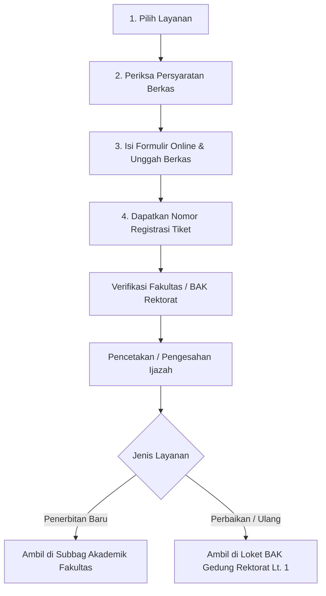

# PRD Portal Layanan Penerbitan Ijazah Universitas Tanjungpura

**Versi Dokumen:** 2.1  
**Status:** Disahkan & Disesuaikan dengan Implementasi Terakhir  
**Tanggal Pembaruan:** 23 Oktober 2026  
**Kepemilikan:** Biro Akademik dan Kemahasiswaan (BAK) Universitas Tanjungpura & Tim Pengembang SimalumApps  

---

## 1. Ringkasan Eksekutif & Visi Produk

Portal Layanan Penerbitan Ijazah Universitas Tanjungpura (UNTAN) adalah ekosistem digital terintegrasi yang melayani mahasiswa tingkat akhir, wisudawan, dan alumni UNTAN dalam pengurusan administrasi ijazah dan dokumen kelulusan secara transparan, akuntabel, dan aman.

Sistem ini berevolusi dari sekadar landing page statis menjadi **Portal Administrasi Kelulusan Terpadu** yang terdiri dari 5 pilar utama:
1. **Beranda & Katalog Layanan** (`public/index.html`)
2. **Panduan & Dokumen Persyaratan** (`public/panduan.html`)
3. **Formulir Pengajuan Permohonan Online** (`public/pengajuan.html`)
4. **Pelacakan Status Pengajuan Real-Time** (`public/lacak.html`)
5. **PixelCrop Studio - Pemotong Pas Foto Standar 4×6 Rust WebAssembly** (`public/crop/`)

Portal ini terintegrasi dengan ekosistem **Simalum Untan**, pangkalan data **PISN Kemdiktisaintek**, serta sertifikasi **Tanda Tangan Elektronik (TTE) BSrE - BSSN**.

---

## 2. Sasaran Pengguna & Pemangku Kepentingan

| Entitas Pengguna | Karakteristik & Kebutuhan Utama |
| :--- | :--- |
| **Wisudawan / Lulusan Baru** | Pengambilan fisik ijazah & transkrip asli pertama kali pasca-yudisium di Subbagian Akademik Fakultas, panduan berkas wisuda, dan pembuatan pas foto 4×6 resmi. |
| **Alumni (Koreksi Data)** | Mengajukan pembetulan ejaan nama, NIK, tempat/tanggal lahir yang tidak sesuai antara dokumen kependudukan (Dukcapil) dan fisik ijazah lama. |
| **Alumni (Kehilangan / Kerusakan)** | Mengajukan Surat Keterangan Pengganti Ijazah (SKPIj) akibat rusak berat/hilang dengan melampirkan berkas kepolisian (STPLK) dan SPTJM. |
| **Biro Akademik & Kemahasiswaan (BAK)** | Verifikator berkas legalitas di Gedung Rektorat Lantai 1, pemantau antrean pengajuan, dan penjamin validitas hukum penomoran ijazah nasional. |
| **Subbagian Akademik Fakultas** | Unit pelaksana verifikasi SK yudisium dan loket penyerahan fisik dokumen ijazah baru bagi lulusan baru fakultas masing-masing. |

---

## 3. Arsitektur Informasi & Struktur Halaman

```
Portal Layanan Penerbitan Ijazah UNTAN
├── 1. Beranda (index.html)
│   ├── Top Header (Logo Resmi Untan, Navigasi Utama, Akses HelpDesk WA, Drawer Mobile)
│   ├── Animated Glassmorphism Hero Section (Fluid Typography Clamp, Aurora Orbs, Badge Verified, Kartu Pas Foto 4x6, Official Partner IAI)
│   ├── Katalog 5 Kartu Layanan Resmi
│   ├── Alur & Prosedur Pengajuan (4 Langkah Transparan)
│   ├── Ringkasan Persyaratan & Dokumen Legalitas (Tabbed Interface)
│   ├── Pusat HelpDesk & Pertanyaan Umum (FAQ Interaktif)
│   ├── Callout Kontak & Jam Layanan Terpadu Gedung Rektorat
│   └── Footer Akademik & Integritas Dokumen BSrE
├── 2. Panduan & Prosedur (panduan.html)
│   ├── Regulasi BAK & Dasar Hukum (Permendikbudristek No. 6/2022)
│   ├── Standar Pas Foto Resmi Wisuda UNTAN (Latar Biru, Kertas Doff)
│   ├── SOP Alur Pengajuan Tiap Kategori Layanan
│   └── Daftar Periksa Berkas & Prosedur Pengesahan
├── 3. Formulir Pengajuan (pengajuan.html)
│   ├── Stepper 4 Tahap (Identitas -> Kategori -> Upload Dokumen -> Konfirmasi & Tiket)
│   ├── Sinkronisasi Data Akademik Simalum Untan
│   ├── Pemilihan Kategori Layanan Dinamis
│   └── Pengumuman Roadmap Ijazah TTE BSrE (Target 2027/2028)
├── 4. Lacak Status Pengajuan (lacak.html)
│   ├── Pelacakan Berkas Berdasarkan NIM atau Nomor Tiket (Contoh: UNTAN-IJZ-2025-0842)
│   ├── Timeline Perjalanan Berkas Real-Time (Verifikasi Fakultas -> Validasi BAK -> TTE Rektorat -> Siap Ambil)
│   └── Informasi Lokasi Pengambilan Berkas Fisik
└── 5. PixelCrop Studio (crop/index.html)
    ├── Engine Pemrosesan Citra Client-Side Rust WebAssembly (Zero Server Upload)
    ├── Rasio Pas Foto Terkunci 4:6 dengan Presets DPI (72 s/d 400 DPI, Default 300 DPI)
    ├── Kanvas Interaktif: Zoom, Pan, Free-drag 8 Handles, Grid Rule-of-Thirds & Crosshair
    └── Dialog Pratinjau & Ekspor Berkas JPEG/PNG Standar Cetak Doff Ijazah
```

---

## 4. Rincian Fungsional 5 Layanan Ijazah

Portal menyajikan 5 klasifikasi layanan resmi dengan aturan dan ketentuan operasional yang telah diselaraskan:

### 4.1. Penerbitan Baru
- **Deskripsi:** Pengajuan dan pencetakan fisik ijazah pertama kali bagi lulusan yang telah disahkan melalui SK Yudisium periode wisuda berjalan.
- **Validasi Data:** Terhubung dengan Penomoran Ijazah Secara Nasional (**PISN Kemdiktisaintek**) dan data **Simalum Untan**.
- **Lokasi Pengambilan Fisik:** **Khusus Penerbitan Baru, ijazah asli dan transkrip nilai diambil langsung di Subbagian Akademik Fakultas masing-masing**, bukan di loket BAK Gedung Rektorat.
- **Biaya:** Gratis (beban SPP/UKT wisuda).
- **CTA:** `Lihat Informasi` / `Akses Formulir Berkas Yudisium`.

### 4.2. Penerbitan Perbaikan
- **Deskripsi:** Pengajuan perbaikan data atau koreksi kesalahan redaksional/ejaan nama, tanggal lahir, NIK, dan gelar pada fisik ijazah terdahulu.
- **Persyaratan Wajib:**
  1. Ijazah dan transkrip nilai asli terdahulu (wajib diserahkan ke BAK untuk penarikan fisik resmi).
  2. Akta kelahiran / Ijazah pendidikan sebelumnya sebagai dokumen pembanding keabsahan.
  3. Surat Rekomendasi/Pengantar dari Dekan Fakultas terkait.
- **Lokasi Pengurusan & Pengambilan:** Loket BAK Rektorat Lantai 1.
- **CTA:** `Lihat Informasi` / `Unduh Template Permohonan Perbaikan`.

### 4.3. Penerbitan Ulang
- **Deskripsi:** Penggantian dokumen ijazah yang mengalami kerusakan berat atau hilang total sesuai ketentuan Permendikbudristek No. 6 Tahun 2022. Dokumen diterbitkan dalam bentuk **Surat Keterangan Pengganti Ijazah (SKPIj)** yang memiliki kekuatan hukum setara ijazah asli.
- **Persyaratan Wajib:**
  1. Surat Tanda Penerimaan Laporan Kehilangan (STPLK) asli dari Kepolisian RI setempat.
  2. Surat Pernyataan Tanggung Jawab Mutlak (SPTJM) bermeterai Rp10.000,-.
  3. Bukti setor tarif PNBP resmi sebesar **Rp 200.000,-** ke rekening BLU UNTAN.
  4. Pas foto standar ijazah 4×6 cm terbaru (3 lembar).
  5. Fotokopi ijazah lama/legalisasi terdahulu (jika ada).
- **CTA:** `Lihat Informasi` / `Unduh Format SPTJM Bermeterai`.

### 4.4. Pencetakan Ulang
- **Deskripsi:** Pengajuan salinan resmi atau duplikat dokumen ijazah berdasarkan arsip rektorat yang telah diverifikasi.
- **Status Operasional Saat Ini:** **Segera Hadir** (*Coming Soon*).
- **Status Tombol:** Non-aktif (*disabled*) dengan label `Menunggu Ijazah TTE Tersedia`. Layanan ini dirancang untuk beroperasi penuh begitu infrastruktur TTE digital diaktifkan.

### 4.5. Ijazah TTE (Tanda Tangan Elektronik)
- **Deskripsi:** Layanan penerbitan ijazah digital asli dengan sertifikat elektronik terenkripsi dari Balai Sertifikasi Elektronik (BSrE) Badan Siber dan Sandi Negara (BSSN).
- **Fitur Utama:** Keamanan kriptografis anti-pemalsuan, verifikasi barcode hash instan, dan hak unduh resmi wisudawan melalui portal.
- **Status Operasional Saat Ini:** **Segera Hadir** (*Coming Soon*).
- **Roadmap & Estimasi Operasional:** **Diperkirakan tersedia untuk yudisium mulai semester genap 2027/2028 secara otomatis** (pembaruan estimasi dari rencana awal).
- **Status Tombol:** Non-aktif (*disabled*) dengan label `Informasi segera tersedia`.

---

## 5. Standar Pas Foto Ijazah & Integrasi PixelCrop Studio

Kualitas dan spesifikasi pas foto adalah faktor kritis yang menentukan kelancaran penerbitan ijazah fisik maupun digital.

### 5.1. Ketentuan Baku Foto Ijazah UNTAN
- **Dimensi Fisik:** 4 × 6 cm.
- **Latar Belakang:** Biru polos (standar resmi wisuda Universitas Tanjungpura).
- **Pakaian:**
  - Pria: Kemeja putih, berdasi, memakai jas hitam/gelap resmi.
  - Wanita: Kemeja putih, memakai blazer hitam/gelap (atau busana muslimah rapi, wajah tampak jelas).
- **Kualitas Cetakan Fisik:** **Wajib menggunakan kertas bertekstur Doff (Matte)**, bukan kertas mengkilap (*glossy*), agar stempel timbul/tinta rektorat melekat sempurna dan tahan puluhan tahun.
- **Wajah:** Menghadap lurus ke depan, tidak mengenakan kacamata hitam/berwarna, kedua telinga terlihat bagi yang tidak berhijab.

### 5.2. Tool Pendukung: PixelCrop Studio (`/crop/`)
Untuk memastikan seluruh calon wisudawan mengunggah dan mencetak pas foto dengan rasio dan ketajaman yang akurat, sistem dilengkapi tool pemroses foto berbasis **Rust WebAssembly**:
- **Eksekusi 100% Client-Side:** Foto diproses langsung di peramban pengguna tanpa dikirim ke server (menjamin privasi data dan kepatuhan perlindungan data pribadi).
- **High-Fidelity Resampling:** Menggunakan algoritma interpolasi Lanczos-3 dari crate Rust `image`.
- **Presets Resolusi Sesuai Standar Cetak Dokumen:**
  - `300 DPI` *(Default Resmi)*: **450 × 660 px** (Standar cetak tajam ijazah UNTAN).
  - `400 DPI`: **600 × 880 px** (Ultra tajam).
  - `Konversi Digital`: **472 × 709 px** (Standar portal akademik).
- **Fitur Interaksi Kanvas:** Zoom (25%–300%), Pan, Rotasi halus (-45° s/d +45°), Rotasi 90°, Flip, Grid Rule-of-Thirds (3×3), dan Crosshair posisi wajah.

---

## 6. Desain Antarmuka, Responsivitas & Optimasi GPU Mobile

### 6.1. Identitas Visual & Estetika
- **Warna Utama:** Navy Institusional UNTAN (`primary: #00173b`, `surface-container: #07132b`), Aksen Keemasan/Oranye Prestasi (`secondary: #fe932c`), Teal/Cyan Keamanan (`#4cd7f6`), dan Emerald WASM (`#00885d`).
- **Tipografi:** Plus Jakarta Sans (Headlines/Display) dan Inter (Body/UI Labels).
- **Desain Hero:** Glassmorphism berlapis dengan animated mesh grid texture, ambient glowing aurora orbs, dan border sheen gradient shimmer.
- **Partner Resmi:** Badge verified resmi *Official Associate Partner Ikatan Arsitek Indonesia (IAI)*.

### 6.2. Optimasi Mobile & Pencegahan Flickering (< 768px)
Berdasarkan perbaikan teknis pada implementasi terkini, sistem menerapkan stabilisasi rendering perangkat keras:
1. **Penonaktifan Efek Strobe:** Pseudo-elemen `glass-hero-panel::after` (sapuan cahaya diagonal 12 detik) dinonaktifkan sepenuhnya pada viewport mobile `< 768px` untuk mencegah efek berkedip/flickering pada GPU seluler.
2. **Fluid Clamp Typography:** Judul Hero `h1` menggunakan formula `text-[clamp(1.75rem,5.2vw,2.5rem)]` dengan baris responsif `leading-[1.2]`, sehingga teks tidak terpotong atau menimbulkan overflow horizontal di layar 320px–420px.
3. **Penyederhanaan Efek Berat di Layar Sentuh:** Animasi pergeseran bola aurora (`animate-orb-1..4`) dan mesh grid disederhanakan pada mode mobile untuk menghemat baterai dan mencegah *GPU thrashing*.
4. **Drawer Navigasi Mobile:** Tombol hamburger dengan ikon dinamis (`menu` <-> `close`) dan penutupan otomatis saat tautan dipilih.

---

## 7. Alur Pengajuan & Pelacakan Tiket

### 7.1. Alur 4 Tahap Pengajuan


### 7.2. Mekanisme Pelacakan Berkas (`lacak.html`)
Pemohon dapat melacak progres secara real-time menggunakan **Nomor Induk Mahasiswa (NIM)** atau **Nomor Tiket Registrasi** (contoh format: `UNTAN-IJZ-2025-0842`):
- **Tahap 1: Berkas Diterima** (Pemeriksaan kelengkapan dokumen awal).
- **Tahap 2: Verifikasi Akademik & Simalum** (Pencocokan SK yudisium dan pangkalan data PDDIKTI).
- **Tahap 3: Validasi Penomoran PISN & Antrean Cetak Blangko** (Proses di kementerian & rektorat).
- **Tahap 4: Dokumen Siap Diambil** (Pemberitahuan lokasi pengambilan fisik beserta persyaratan bawaan KTP asli).

---

## 8. Standar Kualitas, Pengujian & Jaminan Mutu

Implementasi portal telah dilengkapi rangkaian pengujian otomatis dan panduan pemeliharaan:

### 8.1. Suite Pengujian Playwright (`tests/hero_responsiveness.spec.js`)
- **Uji Responsivitas Tipografi:** Memverifikasi ukuran font terkomputasi `h1` berada dalam batas 24px–32px di mobile dan ≥ 36px di desktop.
- **Uji Horizontal Overflow:** Memastikan tidak ada *horizontal scroll/overflow* pada seluruh variasi resolusi gawai (iPhone SE, Pixel 5, Tablet, Desktop 1080p).
- **Uji Non-Flicker Mobile:** Memvalidasi `display: none` pada pseudo-elemen `::after` di viewport mobile.
- **Uji Keabsahan Pengumuman TTE:** Memverifikasi ketersediaan teks pengumuman resmi *"Diperkirakan tersedia untuk yudisium mulai semester genap 2027/2028 secara otomatis"* pada `pengajuan.html`.

### 8.2. Pengujian Unit Engine Crop WASM (`tests/wasm_bridge.test.js` & `wasm_crop/tests/crop_tests.rs`)
- Validasi akurasi cropping persegi panjang aspek rasio 4:6.
- Validasi resampling Lanczos-3 pada seluruh preset DPI (72, 96, 150, 200, 300, 400).
- Uji alokasi dan dealokasi memori WebAssembly tanpa memory leak.

---

## 9. Kontak & Jam Operasional Layanan

- **Unit Layanan:** Biro Akademik dan Kemahasiswaan (BAK) Universitas Tanjungpura
- **Lokasi Fisik:** Gedung Rektorat Lantai 1, Jl. Prof. Dr. H. Hadari Nawawi, Pontianak 78124
- **Jam Operasional Loket:**
  - Senin – Kamis: 08.00 – 16.00 WIB *(Istirahat: 11.30 – 13.00 WIB)*
  - Jumat: 08.00 – 16.30 WIB *(Istirahat: 11.30 – 13.00 WIB)*
  - Sabtu, Minggu & Hari Libur Nasional: Tutup
- **Kanal Bantuan Daring:**
  - WhatsApp HelpDesk BAK: `+62 561 743465`
  - Telepon Kantor: `(0561) 743465`
  - Surel Resmi: `ijazah@untan.ac.id`

---

## 10. Catatan Perubahan Dokumen (Changelog)

| Versi | Tanggal | Ringkasan Pembaruan |
| :--- | :--- | :--- |
| **1.0** | 20 Okt 2026 | Draf awal PRD landing page penerbitan ijazah sederhana dengan 5 kartu layanan. |
| **2.0** | 22 Okt 2026 | Transformasi menjadi PRD portal terpadu: penambahan modul panduan, formulir pengajuan 4-tahap, modul lacak status, dan integrasi PixelCrop Studio Rust WASM. |
| **2.1** | 23 Okt 2026 | **Penyesuaian implementasi terkini:**<br>1. Pembaruan referensi SIAKAD menjadi **Simalum Untan** di seluruh sistem.<br>2. Pembaruan nomenklatur kementerian ke **Kemdiktisaintek** & sistem **PISN**.<br>3. Pembaruan estimasi operasional Ijazah TTE BSrE menjadi **semester genap 2027/2028**.<br>4. Penegasan alur pengambilan fisik Penerbitan Baru di **Subbagian Akademik Fakultas** masing-masing.<br>5. Dokumentasi optimasi mobile: pencegahan flickering/strobe light sweep di HP dan fluid clamp typography.<br>6. Dokumentasi automated test suite Playwright & bukti verifikasi visual. |