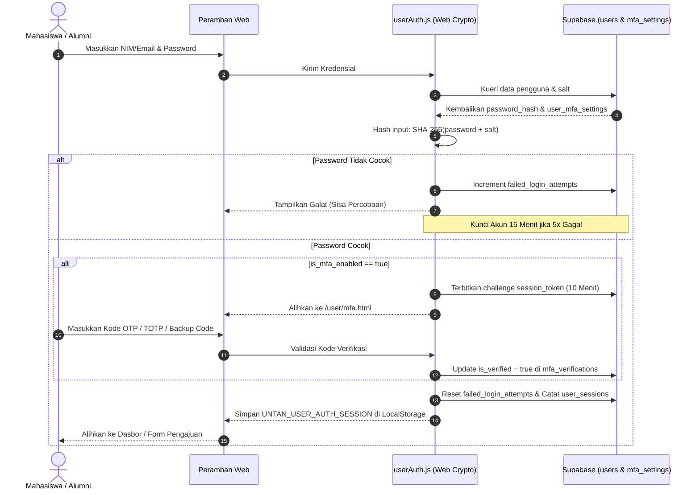
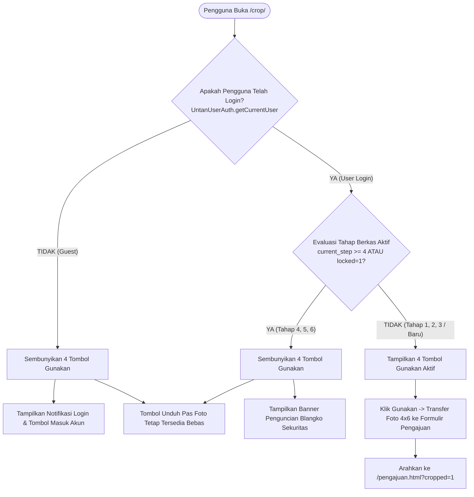
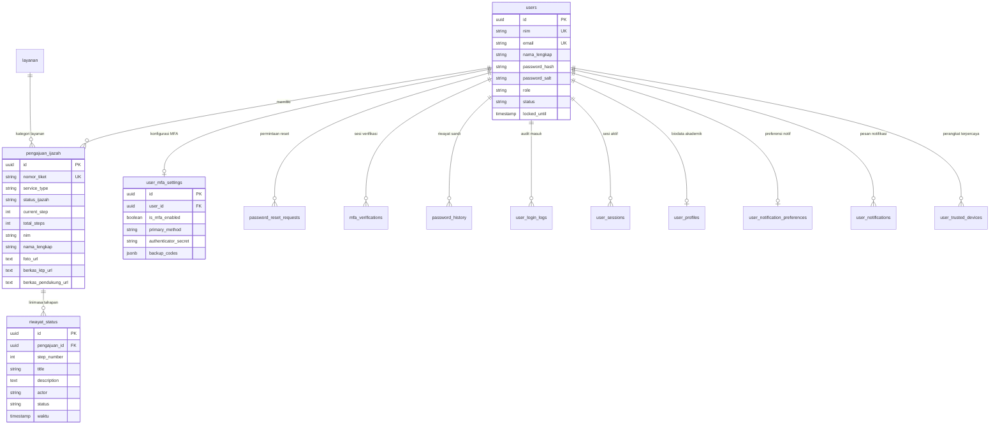

# Arsitektur Teknis Portal Layanan Penerbitan Ijazah UNTAN

Dokumen ini menjelaskan arsitektur teknis, diagram komponen sistem, alur data, spesifikasi keamanan, dan integrasi pangkalan data untuk Portal Layanan Penerbitan Ijazah Universitas Tanjungpura.

---

## 🏗️ 1. Diagram Arsitektur Sistem Global

```mermaid
graph TB
    subgraph Client Tier ["Client Tier (Browser Peramban)"]
        UI_Home["Beranda & Bento Hero<br/>(public/index.html)"]
        UI_Form["Form Pengajuan Terproteksi<br/>(public/pengajuan.html)"]
        UI_Track["Lacak Status Berkas<br/>(public/lacak.html)"]
        UI_User["Portal Akun & Dasbor MFA<br/>(public/user/)"]
        WASM_Crop["PixelCrop Studio WASM<br/>(public/crop/)"]
    end

    subgraph Logic & State Tier ["Client Logic & WebAssembly Tier"]
        Auth_Engine["Web Crypto Engine<br/>(SHA-256 + TOTP RFC 6238)"]
        WASM_Engine["Rust Image Processing<br/>(Lanczos3 Resampling)"]
        MegaMenu_Ctrl["MegaMenu Controller<br/>(public/js/megaMenu.js)"]
        Supa_Client["Supabase API Wrapper<br/>(public/js/supabaseClient.js)"]
    end

    subgraph Cloud Infrastructure ["Cloud Tier (Vercel & Supabase Platform)"]
        Vercel_Edge["Vercel Edge / CDN<br/>(Clean Routing & Headers)"]
        Supa_Auth["Supabase PostgreSQL<br/>(13 Relational Tables)"]
        Supa_Storage["Supabase Storage<br/>(Bucket: dokumen-ijazah)"]
    end

    subgraph Institutional Ecosystem ["External Institutional Systems"]
        Kemdikbud["PISN Kemdiktisaintek / PDDikti"]
        Simalum["Simalum Untan Hub"]
        BSrE["TTE BSrE - BSSN"]
    end

    UI_Home --> MegaMenu_Ctrl
    UI_User --> Auth_Engine
    WASM_Crop --> WASM_Engine
    UI_Form --> Supa_Client
    UI_Track --> Supa_Client
    Auth_Engine --> Supa_Client
    WASM_Crop -.->|"DataTransfer & SessionStorage"| UI_Form

    Client Tier --> Vercel_Edge
    Supa_Client --> Supa_Auth
    Supa_Client --> Supa_Storage
    Supa_Auth -.-> Kemdikbud
    Supa_Auth -.-> Simalum
    Supa_Auth -.-> BSrE
```

---

## 📦 2. Komponen & Lapisan Teknologi (Technology Stack)

| Komponen | Teknologi / Pustaka | Peran & Tanggung Jawab |
| :--- | :--- | :--- |
| **Frontend Framework** | HTML5, Tailwind CSS (CDN & JIT), Material Symbols | Antarmuka responsif mobile-first, arsitektur Bento Grid, Glassmorphism, dan komponen aksesibel. |
| **Core Client Engine** | Rust `image` crate dikompilasi ke WebAssembly (`wasm32-unknown-unknown`) | Pemotongan pas foto 4×6, rotasi halus sub-derajat, transformasi 90°, dan resampling Lanczos3 murni di sisi browser. |
| **Autentikasi & Kriptografi** | Web Crypto API (`window.crypto.subtle`), HMAC-SHA1 TOTP murni JS | Hashing kata sandi SHA-256 + salt unik, generator TOTP RFC 6238 30-detik, token hex 32-byte. |
| **Pangkalan Data** | Supabase Managed PostgreSQL | Penyimpanan relasional 13 tabel, view komposit, trigger pencabutan sesi, dan Row Level Security (RLS). |
| **Penyimpanan Berkas** | Supabase Object Storage (`dokumen-ijazah`) | Isolasi folder `pas-foto/`, `berkas-ktp/`, `berkas-pendukung/`, dan `avatars/` dengan auto-cleanup berkas usang. |
| **Infrastruktur Hosting** | Vercel Serverless Platform | Distribusi CDN global, clean URL rewrites, MIME header `.wasm`, dan proteksi deployment. |
| **Jaminan Mutu (QA)** | Playwright Test Runner (Chromium Desktop & Mobile Pixel 5) | Pengujian end-to-end otomatis (58+ skenario pengujian lulus 100%). |

---

## 🔐 3. Alur Otentikasi & Keamanan Multi-Faktor (MFA)



---

## 🎯 4. Logika Dua Lapis Penguncian Tombol "Gunakan" di PixelCrop Studio



---

## 📊 5. Skema Relasi Antar Tabel (Entity Relationship Overview)


