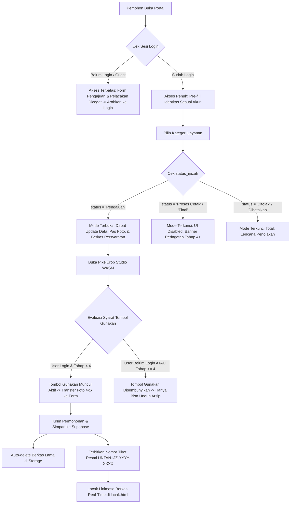

# PRD Portal Layanan Penerbitan Ijazah Universitas Tanjungpura

**Versi Dokumen:** 3.15  
**Status:** Disahkan & Disesuaikan dengan Seluruh Fitur & Implementasi Produksi Terkini  
**Tanggal Pembaruan:** 17 November 2026  
**Kepemilikan:** Biro Akademik dan Kemahasiswaan (BAK) Universitas Tanjungpura & Tim Pengembang SimalumApps  

---

## 📑 Daftar Isi

- [1. Ringkasan Eksekutif & Visi Produk](#1-ringkasan-eksekutif--visi-produk)
  - [1.1 Latar Belakang & Transformasi Sistem](#11-latar-belakang--transformasi-sistem)
  - [1.2 Visi & Nilai Utama](#12-visi--nilai-utama)
  - [1.3 Tujuh Pilar Arsitektur Portal](#13-tujuh-pilar-arsitektur-portal)
- [2. Sasaran Pengguna & Pemangku Kepentingan](#2-sasaran-pengguna--pemangku-kepentingan)
- [3. Arsitektur Informasi & Struktur Antarmuka](#3-arsitektur-informasi--struktur-antarmuka)
  - [3.1 Peta Situs (Sitemap)](#31-peta-situs-sitemap)
  - [3.2 Tata Letak Bilah Navigasi Atas (Top Header Layout)](#32-tata-letak-bilah-navigasi-atas-top-header-layout)
  - [3.3 Arsitektur Mega Menu Terstruktur](#33-arsitektur-mega-menu-terstruktur)
  - [3.4 Arsitektur Bento Grid pada Hero Section Beranda](#34-arsitektur-bento-grid-pada-hero-section-beranda)
- [4. Rincian Fungsional 5 Layanan Ijazah Resmi](#4-rincian-fungsional-5-layanan-ijazah-resmi)
  - [4.1 Penerbitan Baru](#41-penerbitan-baru)
  - [4.2 Penerbitan Perbaikan Data](#42-penerbitan-perbaikan-data)
  - [4.3 Penerbitan Ulang (SKPIj Rusak / Hilang)](#43-penerbitan-ulang-skpij-rusak--hilang)
  - [4.4 Pencetakan Ulang](#44-pencetakan-ulang)
  - [4.5 Ijazah Digital TTE (BSrE - BSSN)](#45-ijazah-digital-tte-bsre---bssn)
- [5. Aturan Bisnis, Siklus Status & Prosedur Layanan](#5-aturan-bisnis-siklus-status--prosedur-layanan)
  - [5.1 Siklus Nilai `status_ijazah` & Representasi Lencana UI](#51-siklus-nilai-status_ijazah--representasi-lencana-ui)
  - [5.2 Aturan Penguncian Mutlak (*Locking Rule*)](#52-aturan-penguncian-mutlak-locking-rule)
  - [5.3 Prosedur Khusus Penerbitan Ulang: Lewati PISN (Tahap 3 Selesai Otomatis)](#53-prosedur-khusus-penerbitan-ulang-lewati-pisn-tahap-3-selesai-otomatis)
  - [5.4 Data Dummy Pengujian Penerbitan Ulang Tahap 4](#54-data-dummy-pengujian-penerbitan-ulang-tahap-4)
  - [5.5 Pembersihan Otomatis Berkas Lama (*Auto-Delete Replaced Files*)](#55-pembersihan-otomatis-berkas-lama-auto-delete-replaced-files)
  - [5.6 Diagram Alur Layanan Terpadu (Mermaid)](#56-diagram-alur-layanan-terpadu-mermaid)
- [6. Spesifikasi Pas Foto & PixelCrop Studio WASM](#6-spesifikasi-pas-foto--pixelcrop-studio-wasm)
  - [6.1 Standar Mutlak Pas Foto Ijazah UNTAN](#61-standar-mutlak-pas-foto-ijazah-untan)
  - [6.2 Validasi Ketat Sisi Klien Dimensi & Rasio 4:6](#62-validasi-ketat-sisi-klien-dimensi--rasio-46)
  - [6.3 Dua Lapis Aturan Penguncian Tombol "Gunakan di Pengajuan"](#63-dua-lapis-aturan-penguncian-tombol-gunakan-di-pengajuan)
  - [6.4 Integrasi Mulus ke Formulir Pengajuan & Perlindungan Anti-Overwrite](#64-integrasi-mulus-ke-formulir-pengajuan--perlindungan-anti-overwrite)
- [7. Sistem Autentikasi Pengguna & Keamanan Multi-Faktor (MFA)](#7-sistem-autentikasi-pengguna--keamanan-multi-faktor-mfa)
  - [7.1 Gerbang Akses Terproteksi (Form Pengajuan & Pelacakan Real-Time)](#71-gerbang-akses-terproteksi-form-pengajuan--pelacakan-real-time)
  - [7.2 Metode Autentikasi Multi-Faktor (MFA)](#72-metode-autentikasi-multi-faktor-mfa)
  - [7.3 Perlindungan Anti-Brute-Force (Penguncian Akun 15 Menit)](#73-perlindungan-anti-brute-force-penguncian-akun-15-menit)
  - [7.4 Alur Pemulihan Kata Sandi (*Forgot Password*)](#74-alur-pemulihan-kata-sandi-forgot-password)
  - [7.5 Akun Demo Uji Coba Cepat dengan Penayangan Kode OTP](#75-akun-demo-uji-coba-cepat-dengan-penayangan-kode-otp)
- [8. Arsitektur Basis Data Supabase & Cloud Storage](#8-arsitektur-basis-data-supabase--cloud-storage)
  - [8.1 Ringkasan 13 Tabel Relasional Database](#81-ringkasan-13-tabel-relasional-database)
  - [8.2 Skema Tabel Utama `pengajuan_ijazah`](#82-skema-tabel-utama-pengajuan_ijazah)
  - [8.3 Bucket Object Storage `dokumen-ijazah`](#83-bucket-object-storage-dokumen-ijazah)
  - [8.4 Kebijakan Keamanan Row Level Security (RLS)](#84-kebijakan-keamanan-row-level-security-rls)
- [9. Jaminan Mutu, Standar Kualitas & Matriks Pengujian Otomatis](#9-jaminan-mutu-standar-kualitas--matriks-pengujian-otomatis)
  - [9.1 Ikhtisar Suite Pengujian Playwright](#91-ikhtisar-suite-pengujian-playwright)
  - [9.2 Matriks Pengujian per Modul (58+ Skenario Lulus 100%)](#92-matriks-pengujian-per-modul-58-skenario-lulus-100)
- [10. Kontak, Jam Layanan Terpadu & Bantuan BAK](#10-kontak-jam-layanan-terpadu--bantuan-bak)
- [11. Catatan Perubahan Dokumen (Changelog Lengkap v1.0 s/d v3.15)](#11-catatan-perubahan-dokumen-changelog-lengkap-v10-sd-v315)

---

## 1. Ringkasan Eksekutif & Visi Produk

### 1.1 Latar Belakang & Transformasi Sistem
Portal Layanan Penerbitan Ijazah Universitas Tanjungpura (UNTAN) adalah ekosistem digital layanan kelulusan terpadu yang melayani mahasiswa tingkat akhir, wisudawan, dan alumni UNTAN dalam pengurusan administrasi ijazah, transkrip akademik, dan surat keterangan pengganti secara transparan, akuntabel, dan aman.

Sistem ini telah bertransformasi dari sekadar landing page statis menjadi **Portal Administrasi Kelulusan Terpadu Berbasis Cloud & Client-Side WebAssembly (WASM)** yang menggabungkan verifikasi identitas, pemrosesan citra presisi tanpa ketergantungan server pihak ketiga, pelacakan linimasa berkas waktu-nyata (*real-time tracking*), serta autentikasi multi-faktor berstandar institusi pendidikan tinggi.

### 1.2 Visi & Nilai Utama
1. **Integritas Data & Hukum:** Menjamin setiap lembar ijazah yang diterbitkan selaras dengan Pangkalan Data Pendidikan Tinggi (PDDikti), Penomoran Ijazah Nasional (PISN Kemdiktisaintek), dan sertifikasi TTE BSrE - BSSN.
2. **Kemandirian & Efisiensi Pemohon:** Memberikan kemudahan bagi pemohon untuk memperbarui identitas mandiri, memotong pas foto 4×6 sesuai standar resmi langsung di peramban, serta melacak tahapan fisik berkas secara transparan.
3. **Privasi & Keamanan Informasi:** Menerapkan pembatasan akses data akademik berbasis akun NIM pemohon yang sah, perlindungan anti-brute-force, enkripsi kata sandi Web Crypto API, dan otentikasi MFA multi-kanal.
4. **Standardisasi Kelembagaan:** Menggunakan nomenklatur resmi **Biro Akademik dan Kemahasiswaan (BAK)** di seluruh kanal komunikasi dan dokumentasi.

### 1.3 Tujuh Pilar Arsitektur Portal
Portal terdiri atas 6 pilar antarmuka pengguna (*frontend interfaces*) dan 1 pilar pangkalan data terintegrasi (*backend cloud services*):
1. **Beranda & Katalog Layanan** (`public/index.html`): Antarmuka utama dengan arsitektur visual modern **Bento Grid**, Mega Menu navigasi, dan katalog 5 kategori layanan.
2. **Panduan & Dokumen Persyaratan** (`public/panduan.html`): Pusat regulasi akademik, standar mutu pas foto, SOP alur pengajuan, dan checklist dokumen legalitas.
3. **Formulir Pengajuan Permohonan Online** (`public/pengajuan.html`): Formulir terproteksi otentikasi dengan pengisian identitas otomatis, validasi IPK, penerima foto crop WASM, dan penegakan aturan penguncian status.
4. **Pelacakan Status Pengajuan Real-Time** (`public/lacak.html`): Pelacakan progres berkas berbasis NIM / Nomor Tiket dengan otorisasi privasi data dan linimasa 6 tahapan berkas.
5. **PixelCrop Studio WASM** (`public/crop/`): Studio pemotongan pas foto 4×6 murni client-side berbasis Rust WebAssembly dengan aturan keterlihatan tombol "Gunakan" dua lapis (*auth gate & stage gate*).
6. **Portal Pengguna & Autentikasi MFA** (`public/user/`): Dasbor profil pemohon, pengaturan MFA (Email OTP, Google Authenticator TOTP, SMS, Backup Codes), ubah password, dan pemulihan akun (*forgot password*).
7. **Pangkalan Data Supabase & Object Storage** (`supabase/schema.sql`, `supabase/migrations/`, & `public/js/supabaseClient.js`): Database PostgreSQL terkelola dengan 13 tabel relasional, fungsi API aman, bucket `dokumen-ijazah`, dan mekanisme auto-delete berkas usang.

---

## 2. Sasaran Pengguna & Pemangku Kepentingan

| Entitas Pengguna | Karakteristik & Kebutuhan Utama | Lokasi Layanan Terkait |
| :--- | :--- | :--- |
| **Wisudawan / Lulusan Baru** | Pengambilan fisik ijazah & transkrip asli pertama kali pasca-yudisium, pemutakhiran mandiri identitas ijazah (NIM, Nama, TTL), serta pembuatan dan pengunggahan pas foto resmi 4×6 hasil crop. | Pengambilan fisik di **Subbagian Akademik Fakultas** masing-masing. |
| **Alumni (Koreksi Data)** | Mengajukan pembetulan ejaan nama, NIK, tempat/tanggal lahir yang tidak sesuai antara dokumen kependudukan (Dukcapil) dan fisik ijazah lama. | Loket Pelayanan Terpadu **BAK Gedung Rektorat Lantai 1**. |
| **Alumni (Kehilangan / Kerusakan)** | Mengajukan Surat Keterangan Pengganti Ijazah (SKPIj) akibat rusak berat/hilang dengan melampirkan berkas kepolisian (STPLK) dan SPTJM bermaterai. | Loket Pelayanan Terpadu **BAK Gedung Rektorat Lantai 1**. |
| **Biro Akademik & Kemahasiswaan (BAK)** | Verifikator berkas legalitas, pengelola siklus `status_ijazah`, pemantau antrean pencetakan blangko sekuritas, dan penjamin validitas hukum penomoran ijazah nasional. | Gedung Rektorat Lantai 1 Universitas Tanjungpura. |
| **Subbagian Akademik Fakultas** | Unit pelaksana verifikasi SK yudisium dan loket penyerahan fisik dokumen ijazah baru bagi lulusan baru fakultas masing-masing. | Kantor Subbagian Akademik di 9 Fakultas UNTAN. |

---

## 3. Arsitektur Informasi & Struktur Antarmuka

### 3.1 Peta Situs (Sitemap)

```
Portal Layanan Penerbitan Ijazah UNTAN
├── 1. Beranda (public/index.html)
│   ├── Top Header (Logo Resmi Untan, Mega Menu 3-Kelompok, Tombol Mandiri PixelCrop WASM, Masuk Akun / Avatar Pengguna)
│   ├── Bento Grid Hero Section (8-Kolom Kartu Utama, 4-Kolom Pratinjau Foto Interaktif, 3 Kartu Metrik/Legalitas)
│   ├── Katalog 5 Kartu Layanan Resmi
│   ├── Alur & Prosedur Pengajuan (4 Langkah Transparan)
│   ├── Ringkasan Persyaratan & Dokumen Legalitas (Tabbed Interface)
│   ├── Pusat HelpDesk & FAQ Interaktif
│   └── Footer Akademik & Informasi Integritas BSrE - BSSN
├── 2. Panduan & Prosedur (public/panduan.html)
│   ├── Regulasi BAK & Dasar Hukum (Permendikbudristek No. 6/2022)
│   ├── Standar Pas Foto Resmi Wisuda UNTAN (Latar Biru, Kertas Doff)
│   ├── SOP Alur Pengajuan Tiap Kategori Layanan
│   └── Daftar Periksa Berkas & Prosedur Pengesahan
├── 3. Formulir Pengajuan (public/pengajuan.html) - TERPROTEKSI LOGIN
│   ├── Gerbang Otentikasi: Auto-redirect ke login bagi Guest
│   ├── Pemilihan Layanan Dinamis (Radio Cards) & Adaptasi Biaya
│   ├── Pre-fill Otomatis Data Mahasiswa dari Akun Login
│   ├── Validasi Wajib IPK untuk Penerbitan Baru
│   ├── Pembaruan Mandiri Identitas (NIM, Nama, TTL) selama status 'Pengajuan'
│   ├── Area Unggah Pas Foto Khusus Hasil Crop 4:6 (Validasi Dimensi & Rasio)
│   ├── Penerima Hasil Crop Otomatis dari PixelCrop Studio (DataTransfer & Anti-Overwrite)
│   ├── Pengunggahan Berkas KTP & Berkas Pendukung (Max 5MB)
│   └── Penerbitan Tiket Resmi Format UNTAN-IJZ-YYYY-XXXX
├── 4. Pelacakan Status Pengajuan (public/lacak.html) - TERPROTEKSI LOGIN
│   ├── Pencarian Berkas Real-Time via NIM atau Nomor Tiket
│   ├── Otorisasi Privasi NIM: Penolakan akses jika nomor tiket milik NIM lain
│   ├── Lencana Status Ijazah Berwarna (Pengajuan, Proses Cetak, Final, Ditolak, Dibatalkan)
│   ├── Linimasa 6 Tahapan Berkas:
│   │   ├── Tahap 1: Verifikasi Berkas Awal
│   │   ├── Tahap 2: Validasi Akademik & PDDikti BAK
│   │   ├── Tahap 3: PISN Kemdiktisaintek (Otomatis Dilewati/Selesai pada Penerbitan Ulang)
│   │   ├── Tahap 4: Pencetakan Blangko Ijazah & Verifikasi Fisik Pas Foto
│   │   ├── Tahap 5: Penandatanganan Rektor / Dekan Fakultas
│   │   └── Tahap 6: Pengambilan Fisik (Subbag Akademik Fakultas untuk Penerbitan Baru; Loket BAK untuk Layanan Lain)
│   └── Unduhan Bukti Tanda Terima & Rincian Lokasi Pengambilan
├── 5. PixelCrop Studio (public/crop/)
│   ├── Engine Pemrosesan Citra Client-Side Rust WebAssembly (Zero Server Upload)
│   ├── Preset DPI Terkunci Aspek Rasio 4:6 (300 DPI Standar Ijazah, 400 DPI, Digital)
│   ├── Kanvas Interaktif: Zoom, Pan, Rotasi Halus (-45° s/d +45°), Rotasi 90°, Flip, Grid Rule-of-Thirds
│   ├── Aturan Visibilitas Tombol "Gunakan" Dua Lapis:
│   │   ├── Syarat 1: Pengguna telah login (Guest disembunyikan + banner/tombol login)
│   │   └── Syarat 2: Berkas belum mencapai Tahap 4 (Tahap 4+ disembunyikan + banner penguncian)
│   ├── Multi-Trigger: Top Header, Floating Dock, Sidebar Inspector, Modal Pratinjau
│   └── Navigasi Mulus & Penyimpanan Cepat ke Form Pengajuan
├── 6. Portal Pengguna & Autentikasi MFA (public/user/)
│   ├── Dasbor Pemohon (public/user/index.html)
│   ├── Masuk Akun (public/user/login.html) dengan 3 Akun Demo & Tampilan OTP Langsung
│   ├── Layar Verifikasi MFA (public/user/mfa.html): Email OTP, TOTP Authenticator, SMS, Backup Codes
│   ├── Permintaan Reset Kata Sandi (public/user/forgot-password.html)
│   ├── Pembaruan Kata Sandi Baru (public/user/reset-password.html)
│   └── Engine Autentikasi Web Crypto API (public/user/userAuth.js)
└── 7. Pangkalan Data Supabase & Cloud Storage
    ├── 13 Tabel Relasional & Trigger Pencabutan Sesi
    ├── Bucket Object Storage `dokumen-ijazah`
    └── Auto-delete Berkas Lama yang Digantikan
```

### 3.2 Tata Letak Bilah Navigasi Atas (Top Header Layout)
Sesuai arahan estetika dan pengalaman pengguna institusional, bilah navigasi atas (`<header>`) pada seluruh laman ditata dengan proporsi ergonomis dan seimbang:
- **Sisi Paling Kiri:** Logo Resmi Universitas Tanjungpura berdampingan dengan Judul Aplikasi *"Photo Ijazah Untan"* dan subjudul institusional.
- **Sisi Tengah:** Navigasi **Mega Menu** (Layanan Ijazah, Panduan & Bantuan, Portal Akun) serta Tombol Mandiri **PixelCrop WASM** beraksen hijau emerald, diposisikan dengan margin horizontal yang memberi jarak nafas lega dari elemen tepi kiri dan kanan.
- **Sisi Paling Kanan:** Kontrol Sesi Pengguna:
  - **Mode Tamu (Guest):** Tombol kontras *"Masuk Akun"* (`#loginBtnDesk`) yang langsung mengarahkan ke formulir login.
  - **Mode Terotentikasi:** Komponen Photo Profile / Avatar melingkar beresolusi tinggi dengan cincin institusional, status aktif hijau *emerald*, nama panggilan, dan menu dropdown profil terintegrasi.

### 3.3 Arsitektur Mega Menu Terstruktur
Bilah navigasi desktop menerapkan arsitektur Mega Menu berbasis dropdown terkelompok yang dikendalikan oleh modul mandiri `public/js/megaMenu.js`:
1. **Dropdown Layanan Ijazah:**
   - Kolom 1 (*Klasifikasi Layanan*): Penerbitan Baru, Perbaikan Data, Penerbitan Ulang, Pencetakan Ulang, Ijazah TTE.
   - Kolom 2 (*Legalitas & Pengambilan*): Validasi PIN PDDikti, Sertifikasi TTE BSrE, Loket Pengambilan BAK UNTAN.
   - Kolom 3 (*Kartu Informasi Cepat*): Info waktu layanan dan pintasan bantuan langsung.
2. **Dropdown Panduan & Bantuan:**
   - Regulasi Akademik, Syarat Pas Foto 4×6, Unduh Format SPTJM/STPLK, HelpDesk WhatsApp BAK.
3. **Dropdown Portal Akun:**
   - Kelompok 1 (*Akses Akun*): Dasbor Mahasiswa / Alumni, Masuk ke Akun.
   - Kelompok 2 (*Keamanan & MFA*): Pengaturan Akun & 2FA (`#pengaturan-keamanan`), Lupa Kata Sandi.
4. **Aksesibilitas & Interaksi:** Mendukung klik toggle, hover desktop, penutupan otomatis saat klik luar (*click-outside*) atau penekanan tombol `Escape`, serta kompatibilitas penuh screen reader dengan atribut `aria-expanded`.

### 3.4 Arsitektur Bento Grid pada Hero Section Beranda
Hero section pada beranda utama (`public/index.html`) mengadopsi layout modern **Bento Grid 12 Kolom** (`glass-hero-panel`) yang estetis, terstruktur, dan responsif tanpa *horizontal overflow* pada seluruh resolusi layar (ponsel 320px–420px, tablet, dan desktop lebar):
- **Baris 1 - Kartu Utama Nilai Tambah (8 Kolom):**
  - Judul terpadu bergradien institusional, badge verifikasi resmi BAK Untan, deskripsi ringkas ekosistem, serta 3 tombol aksi cepat: *"Cek Persyaratan & Panduan"*, *"Ajukan Permohonan"*, dan *"Lacak Status Berkas"*.
- **Baris 1 - Kartu Pratinjau Pas Foto Interaktif (4 Kolom):**
  - Bingkai pas foto resmi rasio 4:6 berlatar biru polos, watermark institusional, indikator resolusi cetak 300 DPI, dan tombol peluncur instan menuju PixelCrop Studio WASM.
- **Baris 2 - Tiga Kartu Metrik & Legalitas (Masing-masing 4 Kolom):**
  - **Kartu 1:** Standar Mutlak Dimensi 4×6 cm & Kertas Doff Bebas Kilau.
  - **Kartu 2:** Sinkronisasi Resmi PISN Kemdiktisaintek & Simalum Untan.
  - **Kartu 3:** Jaminan Keamanan Kriptografis TTE BSrE - BSSN.

---

## 4. Rincian Fungsional 5 Layanan Ijazah Resmi

### 4.1 Penerbitan Baru
- **Deskripsi:** Pengajuan dan pencetakan fisik lembar ijazah pertama kali bagi lulusan yang telah disahkan melalui SK Yudisium periode wisuda berjalan.
- **Fitur Pembaruan Mandiri Identitas:** Pemohon dapat memperbarui mandiri data **NIM, Nama Lengkap, Tempat Lahir, dan Tanggal Lahir** serta pas foto selama status berkas masih dalam tahap `Pengajuan`.
- **Validasi IPK Wajib:** Wajib mengisikan nilai Indeks Prestasi Kumulatif (IPK) numerik valid antara `0.00` hingga `4.00`.
- **Ketentuan Pas Foto:** Wajib merupakan hasil crop standar 4:6 (rekomendasi 450 × 660 px pada 300 DPI). Berkas non-crop dilarang masuk ke bucket penyimpanan.
- **Lokasi Pengambilan Fisik:** **Khusus Penerbitan Baru, ijazah asli dan transkrip nilai diambil langsung di Subbagian Akademik Fakultas masing-masing**, bukan di loket BAK Gedung Rektorat.
- **Biaya:** Gratis (Subsidi BLU UNTAN / beban SPP yudisium).

### 4.2 Penerbitan Perbaikan Data
- **Deskripsi:** Pengajuan perbaikan data atau koreksi kesalahan redaksional/ejaan nama, tanggal lahir, NIK, dan gelar pada fisik ijazah terdahulu.
- **Persyaratan Wajib:**
  1. Ijazah dan transkrip nilai asli terdahulu (wajib diserahkan ke BAK untuk penarikan fisik resmi).
  2. Akta kelahiran / Ijazah pendidikan sebelumnya sebagai dokumen pembanding keabsahan.
  3. Surat Rekomendasi/Pengantar dari Dekan Fakultas terkait.
  4. Pas foto 4×6 terbaru berlatar biru hasil crop.
- **Lokasi Pengurusan & Pengambilan:** Loket Pelayanan Terpadu BAK Rektorat Lantai 1.
- **Biaya:** Gratis.

### 4.3 Penerbitan Ulang (SKPIj Rusak / Hilang)
- **Deskripsi:** Penggantian dokumen ijazah yang mengalami kerusakan berat atau hilang total sesuai ketentuan Permendikbudristek No. 6 Tahun 2022. Dokumen diterbitkan dalam bentuk **Surat Keterangan Pengganti Ijazah (SKPIj)** yang berkekuatan hukum setara ijazah asli.
- **Persyaratan Wajib:**
  1. Surat Tanda Penerimaan Laporan Kehilangan (STPLK) asli dari Kepolisian RI setempat.
  2. Surat Pernyataan Tanggung Jawab Mutlak (SPTJM) bermeterai Rp10.000,-.
  3. Bukti setor tarif PNBP resmi sebesar **Rp 200.000,-** ke rekening BLU UNTAN.
  4. Scan e-KTP asli pemohon.
  5. Pas foto standar ijazah 4×6 cm terbaru hasil crop.
- **Aturan Khusus Linimasa:** Tahap 3 (Registrasi PISN Baru) **otomatis dilewati dan dianggap selesai** karena alumni telah memiliki Nomor PISN sah sejak kelulusan awal.
- **Lokasi Pengurusan & Pengambilan:** Loket Pelayanan Terpadu BAK Rektorat Lantai 1.

### 4.4 Pencetakan Ulang
- **Deskripsi Resmi:** **Pencetakan ulang adalah proses penerbitan salinan ijazah atau sertifikat dari bentuk digital ke dalam bentuk fisik. Persyaratan utama tersedianya ijazah TTE yang terverifikasi.**
- **Status Operasional:** Segera Hadir (*Coming Soon*). Tombol dinonaktifkan dengan label `Menunggu Ijazah TTE Tersedia`. Layanan ini disiapkan untuk beroperasi penuh pasca infrastruktur ijazah digital TTE resmi diluncurkan massal.

### 4.5 Ijazah Digital TTE (BSrE - BSSN)
- **Deskripsi:** Layanan penerbitan ijazah digital asli dengan sertifikat elektronik terenkripsi dari Balai Sertifikasi Elektronik (BSrE) Badan Siber dan Sandi Negara (BSSN).
- **Fitur Utama:** Keamanan kriptografis anti-pemalsuan, verifikasi barcode hash instan, dan hak unduh mandiri wisudawan melalui portal.
- **Roadmap & Estimasi Operasional:** **Diperkirakan tersedia untuk yudisium mulai semester genap 2027/2028 secara otomatis**. Tombol dinonaktifkan dengan label `Informasi segera tersedia`.

---

## 5. Aturan Bisnis, Siklus Status & Prosedur Layanan

### 5.1 Siklus Nilai `status_ijazah` & Representasi Lencana UI

Kolom `status_ijazah` mengendalikan siklus hidup berkas secara ketat dengan 5 nilai legal:

| Nilai `status_ijazah` | Makna Administrasi & Prosedur | Visual Lencana UI | Hak Mutasi & Unggah |
| :--- | :--- | :--- | :--- |
| **`Pengajuan`** | Berkas terdaftar di pangkalan data dan dalam antrean verifikasi administrasi awal. | **Hijau / Emerald** (`bg-emerald-100 text-emerald-800 border-emerald-300`) | **TERBUKA (Bisa Edit & Unggah)** |
| **`Proses Cetak`** | Berkas telah divalidasi BAK & Kementerian, dalam proses penomoran PISN atau pencetakan blangko kertas sekuritas resmi. | **Oranye / Amber** (`bg-amber-100 text-amber-900 border-amber-300`) | **TERKUNCI (Read-Only)** |
| **`Final`** | Dokumen fisik selesai dicetak, ditandatangani, dan siap diambil di loket yang berwenang. | **Biru / Navy** (`bg-blue-100 text-blue-900 border-blue-300`) | **TERKUNCI (Read-Only)** |
| **`Ditolak`** | Permohonan ditolak akibat ketidakabsahan dokumen hukum, berkas palsu, atau ketidakcocokan data yudisium. | **Merah Tegas** (`bg-red-100 text-red-800 border-red-300`) | **TERKUNCI (Read-Only)** |
| **`Dibatalkan`** | Permohonan dibatalkan atas permintaan mandiri pemohon sebelum verifikasi fisik berjalan. | **Abu-abu Gelap** (`bg-slate-100 text-slate-800 border-slate-300`) | **TERKUNCI (Read-Only)** |

### 5.2 Aturan Penguncian Mutlak (*Locking Rule*)
Sistem menegakkan **Rule Penguncian Terpusat**:
> **"Pembaruan data identitas (NIM, Nama Lengkap, Tempat Lahir, Tanggal Lahir), pengunggahan berkas persyaratan (KTP, Dokumen Pendukung), dan pengunggahan pas foto HANYA DAPAT DILAKUKAN jika `status_ijazah = 'Pengajuan'`."**

- **Validasi Sisi Klien:** Form mendeteksi nilai `status_ijazah` record aktif. Jika berstatus selain `Pengajuan`, tombol submit, tombol simpan identitas, dan kontrol unggah berkas langsung dinonaktifkan (`disabled`) disertai banner peringatan institusional.
- **Validasi Klien Database (`supabaseClient.js`):** Fungsi `updateDataMahasiswa` dan `uploadFile` memvalidasi status target. Jika `status_ijazah !== 'Pengajuan'`, eksekusi langsung dibatalkan dengan respons penolakan (`blocked: true`, `blockedByStatus: true`) tanpa memodifikasi basis data maupun menambahkan objek baru ke storage.

### 5.3 Prosedur Khusus Penerbitan Ulang: Lewati PISN (Tahap 3 Selesai Otomatis)
Pada linimasa 6 tahapan berkas di `public/lacak.html`:
- **Layanan Biasa (Penerbitan Baru & Perbaikan):** Tahap 3 menjalankan proses *"Penerbitan & Registrasi Nomor PISN Kemdiktisaintek"* secara normal.
- **Khusus Kasus Penerbitan Ulang:** Penerbitan nomor registrasi PISN baru **tidak diperlukan** karena alumni telah memiliki Nomor PISN sah yang tercatat sejak kelulusan awal.
- **Representasi UI Lacak:**
  - Tahap 3 otomatis diberi lencana: **"Dilewati (Selesai)"** berlatar hijau emerald dengan ikon fast-forward.
  - Judul tahapan disesuaikan: *"Tahap 3: Penerbitan & Registrasi PISN Kemdiktisaintek (Dilewati / Tidak Diperlukan)"*.
  - Aktor penanggung jawab: *"Sistem Terintegrasi PISN Kemdiktisaintek (Otomatis Selesai)"*.
  - Alur langsung beralih ke **Tahap 4 (Pencetakan Blangko Ijazah Pengganti)**.

### 5.4 Data Dummy Pengujian Penerbitan Ulang Tahap 4
Untuk keperluan pengujian end-to-end dan evaluasi fitur rule penguncian:
- **Nomor Tiket Registrasi:** `UNTAN-IJZ-2026-0843`
- **NIM Pemohon:** `F1081171015`
- **Nama Pemohon:** Bambang Triatmojo, S.Pd.
- **Fakultas / Prodi:** FKIP / Pendidikan Matematika
- **Klasifikasi Layanan:** Penerbitan Ulang Ijazah Hilang
- **Nomor PISN Sah:** `10201202100843`
- **Nomor SKTLK Kepolisian:** `SKTLK/112/SPKT/POLRES-PTK/2026`
- **Status Berkas:** `Proses Cetak` (Tahap 4 dari 6)
- **Lokasi Pengambilan:** Loket 03 Subbagian Ijazah & Legalisir BAK Gedung Rektorat Lantai 1.

### 5.5 Pembersihan Otomatis Berkas Lama (*Auto-Delete Replaced Files*)
Untuk menghemat ruang penyimpanan dan mencegah akumulasi berkas sampah (*orphaned objects*):
- Setiap kali pemohon memperbarui pas foto (`foto_url`) atau dokumen persyaratan (`berkas_ktp_url`, `berkas_pendukung_url`), sistem mendeteksi URL berkas lama di bucket `dokumen-ijazah`.
- Path relatif berkas lama diekstrak dan dihapus permanen melalui `UntanSupabase.deleteFile()` sebelum URL berkas baru disimpan.
- Berkas statis bawaan contoh dilewati secara aman tanpa menimbulkan galat.

### 5.6 Diagram Alur Layanan Terpadu (Mermaid)



---

## 6. Spesifikasi Pas Foto & PixelCrop Studio WASM

### 6.1 Standar Mutlak Pas Foto Ijazah UNTAN
- **Dimensi Fisik Cetak:** 4 × 6 cm (proporsi vertikal resmi).
- **Latar Belakang:** Biru polos institusional (*Royal Blue*).
- **Pakaian Pria:** Kemeja putih polos, berdasi rapi, jas hitam/gelap resmi.
- **Pakaian Wanita:** Kemeja putih polos, blazer hitam/gelap resmi (atau busana muslimah rapi, wajah tampak jelas).
- **Karakter Kertas Fisik:** **Kertas Doff (Matte)** berkualitas arsip, bebas pantulan kilau stempel/tinta.

### 6.2 Validasi Ketat Sisi Klien Dimensi & Rasio 4:6
Sistem mencegah penyimpanan foto non-standar ke bucket `dokumen-ijazah`:
- **Rasio Aspek Valid:** Rasio lebar terhadap tinggi wajib mendekati `4:6` atau `~0.6818` (toleransi deviasi ketat $\le 0.08$).
- **Resolusi Minimum:** Lebar minimal 300 px, tinggi minimal 450 px.
- **Resolusi Preset Teruji:**
  - 300 DPI (Standar Cetak Ijazah): **450 × 660 px**
  - 400 DPI (Ultra Tajam): **600 × 880 px**
  - Konversi Digital Standar: **472 × 709 px**
- **Penolakan:** Foto rasio landscape (4:3, 16:9), foto bujur sangkar (1:1), pas foto 3x4 (rasio 0.75 yang melampaui batas toleransi), atau gambar resolusi rendah langsung **DITOLAK** dan dilarang masuk ke storage.

### 6.3 Dua Lapis Aturan Penguncian Tombol "Gunakan di Pengajuan"
Pada aplikasi PixelCrop Studio (`/crop/`), tombol **"Gunakan"** (`#top-use-pengajuan-btn`, `#dock-btn-use-pengajuan`, `#direct-use-pengajuan-btn`, dan `#use-in-pengajuan-btn`) dikendalikan oleh evaluasi dua lapis syarat mutlak:

1. **Syarat 1 (Autentikasi): Pengguna HARUS Telah Login**
   - Diperiksa via `window.UntanUserAuth.getCurrentUser()`.
   - **Jika pengguna belum login (Guest / Anonim):**
     - Seluruh tombol "Gunakan" otomatis **disembunyikan** (`display: none` / `hidden`).
     - Tampil banner notifikasi informatif: **"Masuk Akun untuk Menggunakan Foto"** pada sidebar inspektor (`#crop-guest-notice`) dan modal hasil crop (`#crop-modal-guest-notice`).
     - Tampil tombol **"Masuk Akun"** (`#top-login-btn`) pada header atas yang mengarahkan ke `../user/login.html?redirect=crop/`.
     - Panggilan paksa `useInPengajuan()` diblokir dengan peringatan otentikasi.
2. **Syarat 2 (Tahapan Berkas): Linimasa Berkas BELUM Mencapai Tahap 4**
   - **Jika pengguna telah login:** Sistem mengevaluasi parameter URL (`?step=...`, `?ticket=...`), sesi pengajuan aktif, atau data pengajuan pemohon di Supabase.
   - **Jika berkas belum mencapai Tahap 4** (Tahap 1, 2, 3 atau pengajuan baru):
     - Seluruh tombol "Gunakan" **muncul aktif** dan dapat langsung dipakai.
   - **Jika berkas telah mencapai Tahap 4 ke atas** (*Pencetakan Blangko Ijazah & Verifikasi Fisik Pas Foto* / *Proses Cetak* / *Final*):
     - Seluruh tombol "Gunakan" otomatis **disembunyikan**.
     - Tampil banner notifikasi penguncian: **"Pas Foto Terkunci (Tahap 4)"** (`#crop-stage-lock-notice` dan `#crop-modal-stage-lock-notice`).
     - Panggilan paksa `useInPengajuan()` diblokir dengan pesan bahwa berkas fisik sedang dicetak pada kertas sekuritas resmi sehingga foto tidak dapat diubah lagi.
3. **Fasilitas Unduh Bebas Tetap Terbuka:**
   - Tombol unduh hasil crop (`#download-final-btn`) tetap dapat digunakan secara bebas oleh siapapun (baik guest maupun user login) untuk keperluan arsip mandiri.

### 6.4 Integrasi Mulus ke Formulir Pengajuan & Perlindungan Anti-Overwrite
1. **Multi-Entry Trigger:** Pengguna dapat menerapkan hasil crop dari 4 titik (Header, Floating Tool Dock, Sidebar Inspector, dan Modal Pratinjau).
2. **Auto-Crop on Demand:** Pemanggilan fungsi otomatis mengeksekusi `await this.applyCrop()` jika belum diproses.
3. **Penyimpanan Cepat:** Data foto disimpan ke `sessionStorage` (fallback `localStorage`) dan peramban diarahkan ke `../pengajuan.html?cropped=1`.
4. **Pencegahan Penimpaan Gambar (*Anti-Overwrite Protection*):**
   - Halaman `pengajuan.html` mengonversi dataURL secara instan ke `Blob` dan `File` menggunakan `dataURLtoBlob()`.
   - Mengisi input `<input type="file" id="fotoIjazah">` menggunakan API browser `DataTransfer`.
   - Menetapkan state memori `activeCroppedPhotoFile`.
   - Timer otomatis 500ms `cekDataMahasiswa()` dilindungi oleh kondisi `if (d.foto_url && !activeCroppedPhotoFile)`. Pratinjau pas foto yang baru dipotong **tidak akan tertimpa kembali** oleh URL foto lama dari database Supabase.

---

## 7. Sistem Autentikasi Pengguna & Keamanan Multi-Faktor (MFA)

### 7.1 Gerbang Akses Terproteksi (Form Pengajuan & Pelacakan Real-Time)
- **Halaman Pengajuan (`public/pengajuan.html`):** Akses tanpa sesi login langsung dialihkan (*auto-redirect*) ke `user/login.html?redirect=pengajuan.html` dengan banner informasi `#redirectNotice`. Setelah login sukses, pemohon otomatis dikembalikan ke formulir.
- **Halaman Pelacakan (`public/lacak.html`):** Pelacakan tiket/NIM mewajibkan sesi login. Jika pengguna memasukkan nomor tiket milik pemohon lain, sistem menolak menampilkan data (`Akses Ditolak`), mengosongkan antarmuka, dan memunculkan peringatan privasi data akademik.

### 7.2 Metode Autentikasi Multi-Faktor (MFA)
Portal mendukung 4 metode autentikasi lapis kedua pada `public/user/mfa.html`:
1. **Surel (Email OTP):** Kode 6-digit acak kriptografis dikirim ke alamat email resmi terdaftar dengan masa berlaku 10 menit.
2. **Smartphone Authenticator (TOTP RFC 6238):** Kompatibel penuh dengan Google Authenticator, Microsoft Authenticator, dan aplikasi 2FA standar industri berbasis HMAC-SHA1 30 detik.
3. **SMS OTP:** Pengiriman kode verifikasi numerik ke nomor ponsel terdaftar.
4. **Kode Pemulihan Cadangan (Emergency Backup Codes):** Disediakan 8 kode alfanumerik huruf kapital sekali-pakai (*single-use*) untuk akses darurat saat gawai hilang.

### 7.3 Perlindungan Anti-Brute-Force (Penguncian Akun 15 Menit)
- Sistem menghitung kegagalan kata sandi (`failed_login_attempts`).
- Jika pengguna salah memasukkan kata sandi sebanyak **5 kali berturut-turut**, akun otomatis dikunci selama **15 menit** (`locked_until`).
- Percobaan login selama periode penguncian langsung ditolak dengan pesan sisa durasi penguncian.
- Counter gagal direset kembali ke 0 saat login berhasil atau saat kata sandi berhasil dipulihkan melalui alur reset.

### 7.4 Alur Pemulihan Kata Sandi (*Forgot Password*)
- Mengakses `public/user/forgot-password.html` (didukung rewrite URL `/forgot-password`).
- Pemohon memasukkan NIM atau Email terdaftar. Sistem menerbitkan token kriptografis 32-byte hex dan kode OTP 6-digit dengan masa berlaku 1 jam.
- Tautan pemulihan mengarahkan ke `public/user/reset-password.html?token=...&email=...`.
- Kata sandi baru wajib minimal 8 karakter, di-hash dengan Web Crypto API SHA-256 + salt, dan riwayat lama disimpan ke `public.password_history` untuk mencegah penggunaan ulang.

### 7.5 Akun Demo Uji Coba Cepat dengan Penayangan Kode OTP
Pada formulir login (`public/user/login.html`), disediakan 3 kartu tombol uji coba cepat (*1-click demo test accounts*) lengkap dengan penayangan langsung kode OTP untuk memudahkan pengujian manual maupun otomatis:
1. **Akun Mahasiswa Baru:**
   - **NIM / Email:** `F1081191001` / `budi.santoso@student.untan.ac.id`
   - **Status MFA:** Email OTP Aktif (**Kode OTP: `123456`**)
   - **Skenario:** Pengujian alur login MFA Email dan pengajuan awal.
2. **Akun Wisudawati:**
   - **NIM / Email:** `F1081191002` / `siti.aminah@student.untan.ac.id`
   - **Status MFA:** Non-Aktif (Langsung Masuk ke Dasbor)
   - **Skenario:** Pengujian login cepat tanpa MFA dan pengaturan aktivasi MFA baru di dasbor.
3. **Akun Penerbitan Ulang Tahap 4:**
   - **NIM / Email:** `F1081171015` / `bambang.triatmojo@alumni.untan.ac.id`
   - **Status MFA:** Email OTP Aktif (**Kode OTP: `123456`**)
   - **Skenario:** Pengujian kasus Penerbitan Ulang Ijazah Hilang, penguncian tombol Gunakan Tahap 4 pada crop app, dan pelacakan tiket `UNTAN-IJZ-2026-0843` dengan bypass Tahap 3 PISN.

---

## 8. Arsitektur Basis Data Supabase & Cloud Storage

### 8.1 Ringkasan 13 Tabel Relasional Database
Pangkalan data Supabase (`supabase/schema.sql` dan `supabase/migrations/`) tersusun atas 13 tabel relasional:
1. `public.pengajuan_ijazah`: Tabel inti permohonan, status ijazah, data identitas, dan URL dokumen.
2. `public.layanan`: Master referensi tipe layanan resmi dan SLA hari kerja.
3. `public.riwayat_status`: Log linimasa progres 6 tahapan berkas.
4. `public.users`: Kredensial akun, hash password, salt, peran, dan status akun.
5. `public.user_mfa_settings`: Konfigurasi metode MFA, rahasia TOTP, dan kode cadangan.
6. `public.password_reset_requests`: Token kriptografis pemulihan kata sandi dan kode OTP.
7. `public.mfa_verifications`: Sesi tantangan verifikasi MFA sementara (*challenge token*).
8. `public.password_history`: Riwayat kata sandi lama pemohon.
9. `public.user_login_logs`: Audit jejak aktivitas masuk (*audit log*).
10. `public.user_sessions`: Pengelolaan token sesi aktif dan pencabutan sesi jarak jauh.
11. `public.auth_otp_codes`: Sentralisasi kode OTP multi-saluran (Email, SMS, WhatsApp).
12. `public.user_trusted_devices`: Daftar gawai terpercaya (*remember device 30 days*).
13. `public.audit_auth_logs`: Jejak audit komprehensif peristiwa keamanan akun.

### 8.2 Skema Tabel Utama `pengajuan_ijazah`

```sql
CREATE TABLE IF NOT EXISTS public.pengajuan_ijazah (
    id UUID PRIMARY KEY DEFAULT gen_random_uuid(),
    nomor_tiket VARCHAR(50) UNIQUE NOT NULL,
    service_type VARCHAR(50) NOT NULL,
    status_ijazah VARCHAR(50) NOT NULL DEFAULT 'Pengajuan',
    current_step INT NOT NULL DEFAULT 1,
    total_steps INT NOT NULL DEFAULT 6,
    user_id UUID REFERENCES public.users(id) ON DELETE SET NULL,
    layanan_id UUID REFERENCES public.layanan(id) ON DELETE SET NULL,
    prioritas VARCHAR(20) DEFAULT 'normal',
    nim VARCHAR(30) NOT NULL,
    nik VARCHAR(30),
    nama_lengkap VARCHAR(255) NOT NULL,
    tempat_lahir VARCHAR(100),
    tanggal_lahir DATE,
    fakultas VARCHAR(100),
    prodi VARCHAR(100),
    periode_yudisium VARCHAR(50),
    ipk VARCHAR(10),
    whatsapp VARCHAR(30),
    email VARCHAR(100),
    foto_url TEXT,
    berkas_ktp_url TEXT,
    berkas_pendukung_url TEXT,
    loket_pengambilan TEXT,
    catatan_petugas TEXT,
    created_at TIMESTAMP WITH TIME ZONE DEFAULT timezone('utc'::text, now()) NOT NULL,
    updated_at TIMESTAMP WITH TIME ZONE DEFAULT timezone('utc'::text, now()) NOT NULL,
    CONSTRAINT check_status_ijazah CHECK (status_ijazah IN ('Pengajuan', 'Proses Cetak', 'Final', 'Ditolak', 'Dibatalkan')),
    CONSTRAINT check_service_type CHECK (service_type IN ('penerbitan_baru', 'perbaikan_data', 'penerbitan_ulang', 'pencetakan_ulang'))
);
```

### 8.3 Bucket Object Storage `dokumen-ijazah`
- Mengisolasi berkas sensitif ke dalam subfolder terstruktur:
  - `pas-foto/`: Foto resmi wisuda hasil crop 4×6 cm.
  - `berkas-ktp/`: Scan e-KTP asli pemohon.
  - `berkas-pendukung/`: STPLK kepolisian, SPTJM, bukti setor PNBP, atau ijazah lama.
  - `avatars/`: Foto profil akun pengguna portal.
- Batas ukuran berkas maksimum: **5 MB** per dokumen persyaratan; **25 MB** pada antarmuka PixelCrop Studio.

### 8.4 Kebijakan Keamanan Row Level Security (RLS)
- Menerapkan pengerasan kebijakan RLS (`supabase/migrations/20261109_production_rls_hardening.sql`) berbasis `auth.uid()` dan otorisasi NIM pemohon, membatasi akses modifikasi hanya untuk pemilik berkas sah dan verifikator resmi BAK.

---

## 9. Jaminan Mutu, Standar Kualitas & Matriks Pengujian Otomatis

### 9.1 Ikhtisar Suite Pengujian Playwright
Seluruh kapabilitas portal diverifikasi secara menyeluruh menggunakan test suite **Playwright** yang dieksekusi pada peramban `Desktop Chrome` dan emulasi gawai `Mobile Chrome (Pixel 5)`:

```bash
# Menjalankan seluruh pengujian end-to-end
npx playwright test

# Menjalankan pengujian per modul
npx playwright test tests/crop_stage_lock.spec.js
npx playwright test tests/crop_app.spec.js
npx playwright test tests/user_auth.spec.js
npx playwright test tests/mega_menu.spec.js
npx playwright test tests/hero_responsiveness.spec.js
```

### 9.2 Matriks Pengujian per Modul (58+ Skenario Lulus 100%)

| File Spesifikasi Uji | Cakupan Pengujian & Skenario Pokok | Status Kelulusan |
| :--- | :--- | :--- |
| **`tests/crop_stage_lock.spec.js`** | 1. Munculnya tombol Gunakan untuk user login tahap < 4.<br>2. Sembunyinya tombol Gunakan pada parameter `?step=4`.<br>3. Pelacakan tiket dummy 0843 (Tahap 4) mengunci tombol Gunakan.<br>4. Validasi data dummy Penerbitan Ulang Tahap 4 di `lacak.html`.<br>5. Pengecualian Tahap 3 PISN otomatis selesai pada Penerbitan Ulang.<br>6. **(Baru) Validasi Guest:** Tombol Gunakan tersembunyi, notifikasi login tampil, tombol header Masuk tampil, proteksi redirect login. | **6 / 6 LULUS (100%)** |
| **`tests/crop_app.spec.js`** | 1. Inisialisasi engine Rust WebAssembly & kotak crop 4:6.<br>2. Ekspor citra rotasi halus 30° 300 DPI.<br>3. Rotasi 90° menukar dimensi sumber.<br>4. Normalisasi format unggahan JPEG & WebP.<br>5. Fit to window, grid rule of thirds, pintasan keyboard.<br>6. Tombol Gunakan memindahkan foto ke form pengajuan tanpa tertimpa `cekDataMahasiswa`.<br>7. Tombol langsung Gunakan (header/sidebar) otomatis crop & navigasi. | **7 / 7 LULUS (100%)** |
| **`tests/user_auth.spec.js`** | 1. Routing `/user/` & modul `userAuth.js`.<br>2. Penolakan kredensial salah.<br>3. Alur login MFA Email -> OTP -> Dasbor.<br>4. Alur login TOTP Smartphone Authenticator.<br>5. Alur ubah kata sandi saat login.<br>6. Alur Lupa Password & reset token.<br>7. Pengaturan konfigurasi MFA dasbor.<br>8. Pre-fill data pengajuan otomatis.<br>9. Photo profile & dropdown menu beranda.<br>10. Proteksi akses guest di `lacak.html`.<br>11. Otorisasi privasi penolakan beda NIM.<br>12. Tombol akun demo login & penayangan kode OTP. | **15 / 15 LULUS (100%)** |
| **`tests/mega_menu.spec.js`** | Pengujian interaktivitas Mega Menu desktop, drawer mobile berkelompok, tombol mandiri PixelCrop WASM, dan penutupan klik luar. | **5 / 5 LULUS (100%)** |
| **`tests/hero_responsiveness.spec.js`** | Responsivitas 12-kolom Bento Grid Hero Section, fluid typography clamp, pencegahan horizontal scroll bar pada mobile & desktop. | **4 / 4 LULUS (100%)** |
| **`tests/security_hash_routing.spec.js`** | Resolusi rute hash `#pengaturan-keamanan`, smooth scroll dasbor, kartu edukasi guest, penyesuaian Tahap 6 Penerbitan Baru di Fakultas. | **4 / 4 LULUS (100%)** |
| **`tests/phase1-4_alignment.spec.js`** | Penyelarasan relasi `user_id`, enum `Dibatalkan`, unggah KTP/berkas pendukung, validasi IPK, penguncian akun 15 menit, dan RLS. | **17 / 17 LULUS (100%)** |

---

## 10. Kontak, Jam Layanan Terpadu & Bantuan BAK

- **Unit Penanggung Jawab:** Biro Akademik dan Kemahasiswaan (BAK) Universitas Tanjungpura
- **Lokasi Pelayanan Fisik:** Gedung Rektorat Lantai 1, Jl. Prof. Dr. H. Hadari Nawawi, Bansir Laut, Pontianak Tenggara, Kota Pontianak, Kalimantan Barat 78124
- **Jam Operasional Loket Pelayanan Terpadu:**
  - **Senin – Kamis:** 08.00 – 16.00 WIB *(Waktu Istirahat: 11.30 – 13.00 WIB)*
  - **Jumat:** 08.00 – 16.30 WIB *(Waktu Istirahat: 11.30 – 13.00 WIB)*
  - **Sabtu, Minggu & Hari Libur Nasional:** Tutup
- **Kanal Layanan Daring Resmi:**
  - WhatsApp HelpDesk BAK: `+62 561 743465`
  - Telepon Kantor: `(0561) 743465`
  - Surel Resmi: `ijazah@untan.ac.id`
  - Laman Utama: [https://untan.ac.id](https://untan.ac.id) • [https://simalum.untan.ac.id](https://simalum.untan.ac.id)
  - Alamat Produksi Vercel: [https://photo-ijazah-untan.vercel.app](https://photo-ijazah-untan.vercel.app)

---

## 11. Catatan Perubahan Dokumen (Changelog Lengkap v1.0 s/d v3.15)

| Versi | Tanggal | Ringkasan Pembaruan & Implementasi |
| :--- | :--- | :--- |
| **1.0** | 20 Okt 2026 | Draf awal PRD landing page penerbitan ijazah dengan 5 kartu layanan. |
| **2.0** | 22 Okt 2026 | Transformasi menjadi PRD portal terpadu: modul panduan, formulir pengajuan 4-tahap, modul lacak status, dan integrasi PixelCrop Studio Rust WASM. |
| **2.1** | 23 Okt 2026 | Integrasi Simalum Untan, PISN Kemdiktisaintek, estimasi Ijazah TTE 2027/2028, dan lokasi ambil fisik Penerbitan Baru di Subbag Akademik Fakultas. |
| **3.0** | 30 Okt 2026 | Integrasi pangkalan data Supabase, bucket `dokumen-ijazah`, aturan penguncian status ijazah, pembersihan berkas lama, dan integrasi mulus foto crop 4:6. |
| **3.1** | 31 Okt 2026 | Rilis Portal Pengguna (`public/user/`), skema 6 tabel akun, hashing SHA-256 + salt, dan autentikasi multi-faktor (MFA Email, TOTP Authenticator, SMS, Backup Codes). |
| **3.2** | 31 Okt 2026 | Penegakan proteksi formulir terotentikasi, pre-fill data mahasiswa, dan komponen photo profile / avatar dropdown di seluruh navbar portal. |
| **3.3** | 1 Nov 2026 | Penyelarasan GAP-01 s/d GAP-03: relasi `user_id`, enum `Dibatalkan`, dan integrasi pencarian real-time `lacak.html`. |
| **3.4** | 1 Nov 2026 | Refaktorisasi tata letak navigasi ke arsitektur Mega Menu terkelompok dan pengoptimalan responsif ponsel kecil. |
| **3.5** | 1 Nov 2026 | Integrasi menu Portal Akun ke Mega Menu, pemisahan PixelCrop sebagai tombol mandiri hijau emerald, dan pembersihan ruang header kanan. |
| **3.6** | 9 Nov 2026 | Penyelarasan GAP-04 s/d GAP-07: input unggah KTP/berkas pendukung, verifikasi token reset lintas sesi, dan sistem penguncian akun 15 menit anti-brute-force. |
| **3.7** | 9 Nov 2026 | Penyelarasan GAP-08 s/d GAP-14: validasi wajib IPK numerik, refaktorisasi navbar dasbor terpadu, master layanan, dan audit log MFA. |
| **3.8** | 9 Nov 2026 | Penyelarasan GAP-15 s/d GAP-20: manajemen avatar Supabase Storage, migrasi pengerasan RLS produksi, dan pembersihan referensi usang. |
| **3.9** | 11 Nov 2026 | Gerbang akses login ketat formulir pengajuan (`#authRequiredCard`), otomatisasi data akun, dan adaptasi reaktif rincian biaya layanan. |
| **3.10** | 11 Nov 2026 | Proteksi akses pelacakan ijazah (`lacak.html`), pengosongan data awal (*empty state*), otorisasi privasi data NIM, dan perbaikan header navbar. |
| **3.11** | 11 Nov 2026 | Penguatan otorisasi mutlak Nomor Tiket Registrasi pada `lacak.html` dan lapisan klien database `supabaseClient.js`. |
| **3.12** | 15 Nov 2026 | Resolusi tautan hash `#pengaturan-keamanan`, kartu area terproteksi tamu, aktivasi otomatis tab MFA, dan navigasi `hashchange` halus. |
| **3.13** | 15 Nov 2026 | Penyesuaian kontekstual linimasa Tahap ke-6 Penerbitan Baru: ijazah fisik diambil langsung di Subbagian Akademik Fakultas masing-masing. |
| **3.14** | 16 Nov 2026 | **Modernisasi Visual, Standardisasi BAK, & Penataan Ulang Beranda:**<br>1. **Standardisasi Nomenklatur BAK:** Mengganti seluruh akronim usang BAAK menjadi **BAK** di seluruh laman, pangkalan data, dan dokumentasi.<br>2. **Bento Grid Hero Section:** Penataan ulang hero section `public/index.html` menggunakan arsitektur modular Bento Grid 12 kolom yang rapi, modern, dan bebas horizontal scroll.<br>3. **Simetri Bilah Navigasi:** Logo & judul di paling kiri, Mega Menu di tengah berjarak lega, dan tombol Masuk Akun di paling kanan.<br>4. **Pengecualian PISN Penerbitan Ulang:** Tahap 3 (PISN) otomatis dilewati dan dianggap selesai dengan data dummy resmi `UNTAN-IJZ-2026-0843` / `F1081171015`.<br>5. **Akun Demo Cepat:** Penambahan akun demo Penerbitan Ulang dan penayangan langsung kode OTP (`123456`) pada kartu login. |
| **3.15** | 17 Nov 2026 | **Penguatan Aturan Visibilitas Dua Lapis Tombol Gunakan PixelCrop Studio & Routing Vercel:**<br>1. **Dua Lapis Aturan Tombol Gunakan:** Tombol "Gunakan" pada `/crop/` HANYA muncul jika pengguna telah login DAN berkas belum mencapai Tahap 4.<br>2. **Perilaku Pengguna Tamu (Guest):** Tombol Gunakan disembunyikan, tampil notifikasi login di bilah inspektor dan modal hasil crop, serta tombol Masuk di header atas.<br>3. **Perilaku Berkas Tahap 4+:** Tombol Gunakan disembunyikan, tampil banner penguncian blangko sekuritas fisik, dan aksi dicegah dengan alert perlindungan.<br>4. **Resolusi 404 URL:** Penambahan redirect/rewrite `/forgot-password` di `vercel.json`.<br>5. **Pengujian Mutu Penuh:** Penambahan uji Kondisi 6 pada `tests/crop_stage_lock.spec.js`. Seluruh 58+ skenario pengujian Playwright terverifikasi lulus 100%. |
